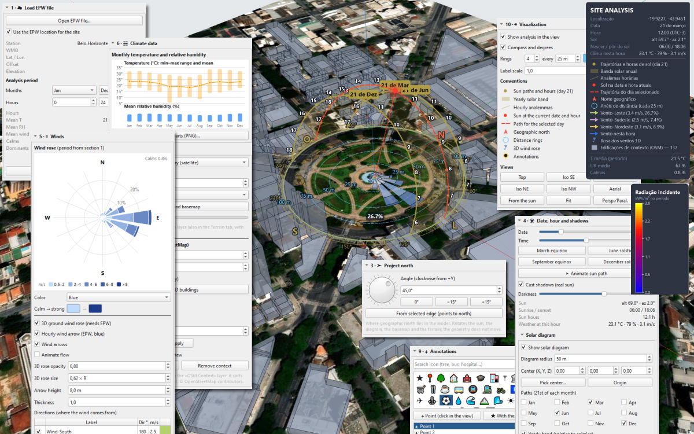
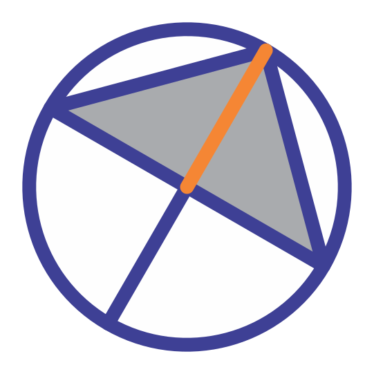
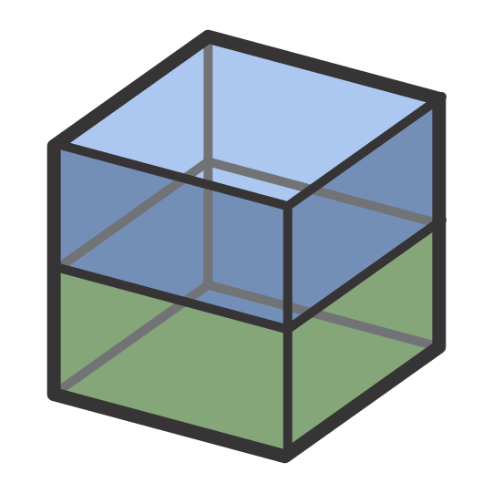
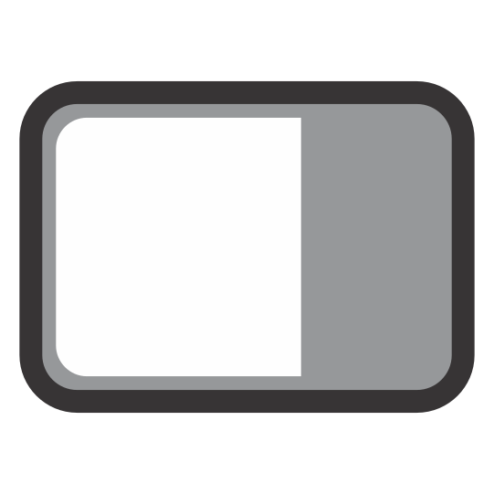

# Site Analysis — IngeTrazo extension

**Site Analysis for IngeTrazo**: 3D sun, real shadows, wind, EPW weather,
solar radiation, OpenStreetMap context, masses and lots with areas/ratios,
annotations, and PNG export — all on the model itself.

It is the web app *Análisis de Sitio 3D* turned into an extension, like a
SketchUp plugin: it does not modify the core, everything enters through
`setup(app)` (Extensions API 2).



## Authorship and credits

The extension is **jufegofoto-cell's work**
([github.com/jufegofoto-cell/IngeAnalisys](https://github.com/jufegofoto-cell/IngeAnalisys)),
who turned the *Análisis de Sitio 3D* web app into an IngeTrazo extension.
**This repository is a fork** with the modifications listed below and does not
claim the original work: the design, the method and the credit are his.
Details of every change and the licence notice: [`CREDITS.md`](CREDITS.md).

What this fork (1.9.0) adds:

- nine language catalogs — pt-BR, es, en, de, it, fr, zh-CN, ru, ja
  (`IngeAnalisys/i18n/`);
- the code organised in folders — `tools/`, `i18n/`, `icons/`, one package with
  `__init__.py` and `setup(app)`;
- one unified toolbar with 19 buttons and theme-aware SVG icons
  (`tools/toolbar.py`);
- draggable floating panels: information and conventions, and the colour scale
  of the radiation and shade maps;
- fixes to keyboard shortcuts and to dialog loading. It has been tested and
  works.

Maintained by Ezequiel M. Rezende ([@em-rezende](https://github.com/em-rezende)).
Projects saved with the original version open the same way: its document keys
(`analisis_sitio`, `group.ext["analisis_sitio"]`) are still read.

## Installation

**From the catalog** (the easy way): **Extensions ▸ Manage extensions…**,
find «Site Analysis», install and restart. The manager downloads
`dist/IngeAnalisys.zip`, checks its SHA-256 and unpacks it as
`plugins/ingeanalisys/` for you.

**By hand**, from this repository or from `dist/IngeAnalisys.zip`:

1. In IngeTrazo: **Extensions ▸ Open plugins folder**
   (Windows `%APPDATA%\ingetrazo\plugins\`, Linux/macOS `~/.local/share/ingetrazo/plugins/`).
2. Copy **only** the `IngeAnalisys` folder (or unzip `IngeAnalisys.zip`
   inside the plugins folder). The path must be
   `plugins/IngeAnalisys/__init__.py`: a plugin is a Python package, and a
   folder holding another folder is not one — IngeTrazo says so in the
   menu instead of loading it.
3. Restart IngeTrazo. The **Site Analysis** tab appears in the side shelf,
   the **Extensions ▸ Site Analysis** submenu is created, and one
   horizontal toolbar (**Site Analysis**) is added.

Requirements: IngeTrazo ≥ 0.6.1 (extensions API 2). No extra dependencies
(PySide6 + NumPy, already bundled).

Both routes are the same code: the plugin is a package folder with
`setup(app)` and no `Tool` subclasses, so nothing is added to the drawing
tools — installing it under either folder name is fine, and a project saved
with one opens with the other (the data keys of both are read;
`IngeAnalisys/tools/data.py`).

## Publishing it in the extension catalog

`catalog/ingeanalisys.toml` holds the entry for
[`ingetrazo-extensions`](https://github.com/ingelibre/ingetrazo-extensions):
name, summary and licence in Spanish/English/Portuguese, the download
address (`…/v1.9.0/dist/IngeAnalisys.zip`) and the SHA-256 of that exact
file.

1. `python scripts/build_zip.py --update-catalog` — builds
   `dist/IngeAnalisys.zip` (one folder, `__init__.py` inside) and writes its
   version and hash into the entry.
2. `python scripts/check_plugin.py` — imports the package the way IngeTrazo
   does, then checks the entry, the ZIP and the picture against the rules of
   that repository.
3. Commit, tag (`v1.9.0`) and push. The tag is part of the download address:
   what a reviewer reads must not change afterwards.
4. In `ingetrazo-extensions`, create `extensions/ingeanalisys.toml` with the
   content of `catalog/ingeanalisys.toml` and upload
   `screenshots/ingeanalisys.jpg` (made by `python scripts/make_screenshot.py`,
   under 600 KB). Open the pull request.

A new version is a new tag, a new ZIP and an entry with `version`,
`download` and `sha256` updated — nothing else.

## Languages

The extension ships with **English** (built-in keys), **Portuguese
(Brazil)**, **Spanish**, **German**, **Italian**, **French**, **Chinese
(Simplified)**, **Russian** and **Japanese** catalogs under
`IngeAnalisys/i18n/` (`pt-BR.json`, `es.json`, `de.json`, `it.json`,
`fr.json`, `zh-CN.json`, `ru.json`, `ja.json`). The language is resolved
in this order:

1. `i18n.set_language(<explicit>)` — highest priority.
2. IngeTrazo's `core.i18n.current_language()` (or `app.settings["language"]`
   when the host exposes it).
3. OS locale via `QLocale.system()`:

   - `pt*` → `pt-BR`
   - `es*` → `es`
   - `de*` → `de`
   - `it*` → `it`
   - `fr*` → `fr`
   - `zh*` → `zh-CN`
   - `ru*` → `ru`
   - `ja*` → `ja`
   - anything else → `en`

Missing keys fall back to the English string, so a partial translation never
breaks the UI. To change the language at runtime:

```python
import importlib, sys
# The host loads the package by path, as ingetrazo_plugin_<folder>: the name
# depends on the folder (IngeAnalisys by hand, ingeanalisys from the catalog).
pkg = next(k for k, m in sys.modules.items()
          if (getattr(m, "__file__", "") or "").replace("\\", "/")
              .endswith("/IngeAnalisys/__init__.py")
          or (getattr(m, "__file__", "") or "").replace("\\", "/")
              .endswith("/ingeanalisys/__init__.py"))
i18n = importlib.import_module(pkg + ".tools.i18n")
i18n.set_language("pt-BR")          # or "es", "de", "it", "fr",
                                    # "zh-CN", "ru", "ja", "en"
```

Then rebuild the panel/dock (reloading the extension) so labels created at
build time pick up the new language. On the next launch, the language is
re-detected from the host / OS locale; `set_language(...)` is not persisted
in the document.

## The panel, section by section

The side tab follows the same order as the web app. Each section is
collapsible; the number in the title matches the tab order.

### 1 · ☁ Load EPW file

- **Open EPW file…** — reads the file (UTF-8 or Latin-1) and stores a
  compact, rounded copy in the `.igz` (`≈ 400 kB`). The original EPW is not
  needed to reopen the document. The file dialog starts in the user's
  **Downloads** folder.
- **Use the EPW location for the site** — when checked, the EPW coordinates
  and time zone become the project location (IngeTrazo's `scene.georef`).
- **Analysis period** — month range (`m0`–`m1`) and hour range (`h0`–`h1`).
  Periods can wrap the year (Nov → Feb) or the night (20 → 6).
- **Statistics** for the period: hours, mean T (with min–max), mean RH,
  mean wind, calms, and the three dominant sectors (non-adjacent).
- **Remove EPW** — clears the stored climate. One undo step.

### 2 · ◉ Location

- **Search address or paste «lat, lon»** — geocodes with the IngeTrazo
  geocoder, or accepts `lat, lon` typed directly.
- **Pick on the map…** — opens IngeTrazo's location picker on the current
  basemap.
- **Latitude / Longitude / Apply coordinates** — set the datum manually.
- **Time zone** — `Automatic (by longitude)` or a fixed UTC offset.
- **Name** — free-form site name; used in exports and the info panel.

Moving the site when the project already has a location asks for
confirmation: the origin moves to the new point and the geometry keeps its
local coordinates.

### 3 · ➤ Project north

- **Dial + numeric angle (clockwise from +Y)** — where geographic north lies
  in the model. Rotates the sun, the solar diagram, the basemap and the 3D
  terrain; **the geometry does not move**.
- **0° / −15° / +15°** — quick nudges.
- **From selected edge (points to north)** — two ways to use it:
  - **Panel**: select a single model edge (drawn south → north) and click
    the button in the panel. The angle is computed immediately.
  - **Toolbar (`➤`)**: click the button, then click the edge directly in
    the 3D view. The plugin watches the selection for ~150 ms and applies
    the north as soon as exactly one edge is selected.

### 4 · ☀ Date, hour and shadows

The date and hour here are the **real ones** used by IngeTrazo's shadows:
moving them moves the model's shadows, and moving the shadows (from the
Shadows panel) moves this panel. A single truth.

- **Date** slider (1–365) and **Time** slider (0–24 in 15-minute steps).
- **March / June / September / December** buttons: jump to the equinoxes and
  solstices.
- **▶ Animate sun path / ■ Stop** — sweeps the day at 0.25 h per frame. The
  sweep also drives the real shadows; you can stop it from the panel or the
  toolbar.
- **Cast shadows (real sun)** — toggles `scene.shadows.enabled` (same action
  as IngeTrazo's Shadows toolbar button).
- **Darkness** — shadow darkness (0–100 %).
- **Sun info** — altitude, azimuth, sunrise/sunset, sun hours today, and
  weather at the current hour (from the EPW, if any).

#### Solar diagram (subsection)

- **Show solar diagram** — master on/off for the 3D diagram in the view.
- **Diagram radius** and **Center (X, Y, Z)** — geometry of the sky dome.
  **Pick center…** runs a one-click tool to place it; **Origin** resets to
  (0, 0, 0).
- **Paths (21st of each month)** — checkboxes for each month to draw.
- **Yearly band (solstice to solstice)**, **Hourly analemmas**,
  **Path for the selected day**, **Hour and month labels**,
  **Sun ray to the center** — toggles.
- **Diagram / Sun** color buttons.

### 5 · ≋ Winds

- **Wind rose** — EPW-based, 16 sectors × 5 speed ranges. The period is the
  one set in section 1. Colors: **Amber / Blue / Teal / Green / Purple /
  Red / Gray / Custom**. The **Calm → strong** two-color swatch only applies
  to the `Custom` palette.
- **3D ground wind rose (needs EPW)** — draws the same rose on the ground.
  Has **opacity** and **size (× R)**.
- **Hourly wind arrow (EPW, blue)** — shows the wind at the current hour of
  section 4.
- **Wind arrows / Animate flow** — draws the wind table arrows; `Animate`
  makes the ribbon pulse.
- **Directions table** — one row per arrow: on/off, label, direction
  (where the wind comes from), speed (m/s), color. Double-click the color
  to change it. **+ Add** / **Remove**.
- **Apply dominant winds (EPW)** — replaces the table with the three
  dominant sectors from the EPW (also available on the toolbar as `◑`).

### 6 · ☵ Climate data

- **Monthly temperature and relative humidity** chart from the EPW (whole
  year, regardless of the analysis period).
- **Save charts (PNG)…** — saves the wind rose and the monthly chart to
  disk. The dialog starts in the user's **Documents** folder with the name
  `climate.png`, producing `<stem>_rose.png` and `<stem>_months.png`.

### 7 · ▦ Basemap and context

**Basemap** (this is IngeTrazo's own basemap layer):

- **Map source** — presets plus **Custom tile URL (XYZ)…**
- **URL** — only shown when `Custom` is selected. Must contain `{z}`,
  `{x}`, `{y}`.
- **Extent** (m) and **Zoom** (`Automatic` or fixed).
- **Download basemap**.
- **Show map** and **Opacity** — they act on the live tile layer.

**Context buildings (OpenStreetMap)**:

- **Radius** and **Default height** — Overpass query parameters.
- **Seat on the 3D terrain (if any)** — when IngeTrazo's terrain is on, each
  building sits on the lowest terrain height under its footprint.
- **Load 3D buildings** — runs the Overpass download in a background thread;
  the main thread only touches the document when the reply arrives.
- **Show buildings** — hides/shows the context group (locked layer
  `OSM Context`).
- **Color** and **Opacity** — restyle the group without rebuilding it.
- **Height scale** — multiplies every building height (`×`). Applies on
  **Apply**.
- **Edit buildings: click in the view** — turns `Select` clicks on context
  buildings into selection. The **Building** panel below shows the picked
  building's name and lets you change **Height** and **Base**, **Hide** it,
  or **Show hidden** for all.
- **Remove context** — deletes the OSM group (one undo step).

### 8 · ⬛ Masses and lots

A **mass** is a normal model group that remembers its footprint, height,
base and kind in `group.ext["analisis_sitio"]`. It moves, rotates, paints,
exports to OBJ/SKP/IFC like any other group, and **casts shadow**. A **lot**
is the same but without height (flat footprint with area).

- **⬛ Mass from selection** / **▬ Lot from selection** — convert the
  selected horizontal face(s) into masses/lots. The face becomes the base
  and is removed from the loose model (one undo step).
- **Initial height** and **Floor height** — defaults used when creating new
  masses.
- **Masses list** — one row per mass/lot with its type, height, floors and
  area. Selecting a row opens the properties below.
- **Properties**: **Name**, **Type** (Mass / Lot), **Height**, **Floors**
  (recomputes height from floor height), **Base elevation**, **Color**,
  **Opacity**.
- **Stats**: footprint area, perimeter, volume, gross floor area (with
  floor count), top elevation.
- **⟲ 15° / ⟳ 15° / Duplicate / Select / Delete** — one-shot operations.
- **Summary** below the list shows totals: number of masses, total
  footprint, gross floor area, volume, lot area, floor-area ratio, building
  ratio.

### 9 · ⌖ Annotations

- **Search icon** — filters the icon list by English or translated name.
- **Icon list** — click to choose the icon for the next annotation.
- **⌖ Point (click in the view)** — pick tool, plain dot.
- **★ With the selected icon** — pick tool, uses the chosen icon.
- **Annotations list** — one row per annotation.
- **Text** — label. **Use selected icon** / **Remove icon** / **Delete**.
- **Annotation style**: **Icon · Text · Line** colors, **Circular
  background / label**, **Size**, **Height**, **Leader line to the
  ground**, **Show text**. **Apply style to all** clears per-pin overrides
  so every annotation uses the current style.
- With the Select tool, clicking an annotation selects it; **Del** removes
  it.

### 10 · ◐ Visualization

- **Show analysis in the view** — master on/off (`view["on"]`).
- **Compass and degrees** — draw the graduated compass.
- **Rings** — count, step, color.
- **Label scale** — size multiplier for all on-canvas labels.
- **Conventions** — live legend of everything currently visible in the
  view (symbol + name; values live in their sections).
- **Views** — **Top**, **Iso SE/SW/NE/NW**, **Aerial**, **From the sun**,
  **Fit**, **Persp./Paral.**

### 11 · ☀ Solar radiation and shadows

Both computations run on the model itself and leave a colored group in the
view, in the `Solar radiation` layer. **Only one map is shown at a time** —
section 11's **Result in the view** dropdown switches between them.

**Common inputs (both studies)**:

- **Surfaces** — Whole model (excluding OSM context) / Masses and lots /
  Selection (faces or groups) / Ground only.
- **Resolution** — Per surface (one color per face), or 2 / 1 / 0.5 m grid.
- **Surrounding ground** with margin — adds a square ground mesh under the
  model (trimmed below building bases and lots).

**Incident solar radiation**:

- **Period** — Day in section 4 / One month / Analysis period (section 1) /
  Full year.
- **Ground albedo** — 0 … 0.9.
- **☀ Compute radiation** — run the computation.
- Method: **direct** (ray-traced against all visible geometry, including
  the OSM context) + **isotropic diffuse** (from the real sky view, using
  Tregenza's 145 patches) + **ground reflection** (albedo). Weather from
  the EPW; if none is loaded, a theoretical clear sky is used and the
  hint below the button says so.
- **Result**: kWh/m², with a **floating color-scale panel** (draggable, see
  below) that can be toggled with
  `Show floating scale panel (radiation / shadows)`.
- **Colors**: Ecotect / Grays / Thermal.
- **Automatic scale (min–max)** or **Minimum / Maximum** set by hand.

**Shadow study**:

- **From / To** and **Interval** (15 / 20 / 30 / 60 min). Defaults to the
  day of section 4.
- **◑ Compute shadow study** — run it.
- Each cell accumulates the **hours in shadow** at each sampled sun
  position (both cast and self shadow).
- **Show**: **Shade hours** or **Sun hours (insolation)**. Colors stay per
  point when switching between the two — only the labels change.
- **Colors**: Grays (white = sun, black = shadow), **Ecotect by hours**
  (one class per hour, yellow = sun → navy = shadow), Thermal.

Both maps are **locked groups in the `Solar radiation` layer**: they save
to the `.igz`, are removed in one undo step, and never interfere with
selection.

### 12 · ⇩ Export image

- **Resolution** — FHD / 2K / 4K / 5K.
- **Export image (PNG)…** — saves the current view with the whole analysis
  on top, including the floating info panel and the radiation/shadow scale
  when visible. The dialog starts in the user's **Documents** folder with
  the name `<site_name>_analysis.png` (or `site_analysis.png` if the site
  has no name).
- **Panel title** and **Position** (TR / TL / BR / BL) — the floating info
  panel.
- **Show floating info and conventions panel** — toggles the panel. It is
  **hidden at startup**: it is a session setting, not a document setting
  (a `.igz` does not turn it back on).

## Floating panels

The extension draws two draggable floating panels on top of the 3D view:

- **Site Analysis** — the info and conventions panel (enabled from
  section 12). It includes the site, date, hour, sun, current weather, a
  live legend of everything visible, and the mean climate of the analysis
  period.
- **Radiation / Shadows** — the color scale of the currently displayed
  radiation or shadow map (enabled from section 11). It only appears when
  there is a visible map *and* the corresponding checkbox is checked.

Both panels can be dragged with the mouse to any corner of the view. They
are saved to the `.igz` implicitly (their enabled/disabled state) but their
on-screen position is a session setting. When you export the view to PNG,
both panels are included in the image at their current position.

## Toolbar

One horizontal toolbar (**Site Analysis**) is created at `setup()`. It is
`Movable` and `Floatable`, has a distinct `objectName` (so the host can
save/restore its position), and can be hidden through the native
**View ▸ Toolbars** menu.

Every button uses an **SVG icon from `icons/`** — the same file for the
dark theme (`<name>.svg`, light strokes) and for the light theme
(`<name>_light.svg`, dark strokes). The loader is `tools/icons.py`; if an
SVG is missing, the button falls back to a Unicode glyph so nothing breaks.

The buttons are grouped exactly in the same order as the panel sections
(1 to 12), with a separator before the panel on/off button at the end.

| Section | Icon | Tooltip | Action | Shortcut |
|---|---|---|---|---|
| 1  |         | Open EPW…                       | `panel._on_open_epw()`            | `Shift+Y`     |
| 2  |         | Pick location on the map…       | `panel._on_pick_map()`            | `Shift+K`     |
| 3  |       | Set north from selected edge    | `panel._on_pick_north_edge()`     | `Shift+C`     |
| 4  |         | Show / hide analysis            | `act.toggle_analysis(sitio)`      | `Shift+H`     |
| 4  |        | Animate the sun path            | `panel._on_anim()`                | `Shift+Space` |
| 5  |        | Apply dominant winds (EPW)      | `panel._on_dominant()`            | `Shift+W`     |
| 6  |       | Save climate charts (PNG)…      | `panel._on_save_charts()`         | `Shift+G`     |
| 7  |     | Download basemap                | `panel._on_basemap()`             | `Shift+B`     |
| 7  |         | Load OSM buildings              | `panel._on_osm()`                 | `Shift+O`     |
| 7  |     | Remove OSM context              | `act.set_context(sitio, None, …)` | `Shift+Delete`|
| 8  |        | Mass from selected faces        | `panel._make_masses("mass")`      | `Shift+M`     |
| 8  |         | Lot from selected faces         | `panel._make_masses("lot")`       | `Shift+L`     |
| 9  |        | Annotate with the selected icon | `panel._place_pin(True)`          | `Shift+A`     |
| 10 |    | Top view                        | `panel.set_view("top")`           | `Shift+5`     |
| 10 |         | Fit to site                     | `panel.set_view("fit")`           | `Shift+0`     |
| 11 |         | Compute radiation               | `panel._on_rad()`                 | `Shift+R`     |
| 12 |      | Export PNG…                     | `panel._on_png()`                 | `Shift+E`     |
| 12 |        | Show / hide the info and conventions panel | `panel._on_notes(checked)` | `Shift+I`     |
| —  |       | Show / hide the analysis panel  | `app.show_panel(dock)` / `dock.hide()` | `Shift+P` |


`👁`, `▶`, `🎛` and `⚙` are **checkable** and stay in sync with the
document (`view["on"]`), the sun animation timer (`sitio.animating_sun`),
the info panel (`sitio.show_notes`) and the dock's visibility. The sync is
done from `panel.refresh()`, so any path that refreshes the panel (document
change, user interaction, menu action) also refreshes the toolbar.

### Icon variants (dark / light theme)

`tools/icons.py` picks the right variant automatically from the window
palette:

- **Dark theme** (`QPalette.Window` lightness < 128): `icons/<name>.svg`
  (light strokes, white).
- **Light theme** (lightness ≥ 128): `icons/<name>_light.svg`
  (dark strokes, black); if the `_light` file is missing, the base file
  is used.

The Markdown table above references the **`_light`** variant because most
Markdown viewers use a light background. In a dark reader, swap `_light`
for the base name.

### Customizing the toolbar

- **Add an action**: in `tools/toolbar.py`, add one `_add(...)` call in
  `build()` and drop the SVG in `icons/`. Buttons must call `panel.*` or
  `actions.*` — never contain business logic. New tooltips must go through
  `tr()` and be added to every catalog under `i18n/`.
- **Remove a button**: delete the matching `_add(...)` call.
- **Persist state**: the toolbar has an `objectName`; if the host calls
  `QMainWindow.saveState()/restoreState()`, its position (and visibility)
  is restored on restart.

## Where dialogs start

To avoid opening at the IngeTrazo installation folder, the file dialogs
start in user folders:

- **Open EPW…** → the **Downloads** folder.
- **Save charts (PNG)…** → the **Documents** folder, suggested name
  `climate.png`.
- **Export image (PNG)…** → the **Documents** folder, suggested name
  `<site_name>_analysis.png` (or `site_analysis.png`).

You can always navigate elsewhere from inside the dialog.

## Document data

`plugin_data["analisis_sitio"]` (pins and winds, with undo),
`analisis_sitio.view` (visualization settings), `analisis_sitio.climate`
(compact EPW), `analisis_sitio.context` (OSM buildings). Masses:
`group.ext["analisis_sitio"]`.

Old documents that still use the previous key names
(`.vista` / `.clima` / `.contexto`) and the previous Spanish/Portuguese
layer names are migrated transparently on the first save (see
`tools/data._LEGACY_KEYS` and `tools/i18n.migrate_layers`).

## Differences from the web app

- **Import** (OBJ/DXF), **modeling** and **OBJ export** are IngeTrazo's
  job; the extension works on the current model.
- **Basemap tone (light/dark)** and **recolor of green areas** do not
  apply: the map is IngeTrazo's basemap layer (it does have opacity).
- **Icon library** uses Unicode glyphs for annotations. On systems without
  an emoji font the annotation draws a colored dot instead of the missing
  glyph. The **toolbar** uses SVG icons from `icons/`.
- **Annotations are always upright** (the "on the ground" option from the
  web app is gone).
- **Extra**: one unified toolbar with 19 buttons (the web app has none),
  and two draggable floating panels.

## Known limitations

- Annotations are always drawn facing the viewer; the web app's "on the
  ground" option does not exist here.
- The basemap's light/dark tone is IngeTrazo's; only its opacity is
  adjustable from this extension.
- Icon glyphs in annotations depend on the fonts installed on the system.
  If a glyph is missing, a colored dot is drawn instead.
- Some keyboard shortcuts may collide with other extensions or with the
  host. All shortcuts live in `tools/toolbar.py` and can be changed
  freely.

## File structure

```
IngeAnalisys/            the plugin itself — the folder IngeTrazo installs
  __init__.py          setup(app): i18n, panel, dock, overlay, pickables,
                       menus, context menu, outliner, toolbar
  tools/
    __init__.py        package marker
    actions.py         GUI-free operations (used by panel, menus, tests)
    charts.py          wind rose and monthly climate
    climate.py         EPW, statistics, rose, OKLab palettes
    core.py            controller: site, hour (= shadows), climate, animation
    data.py            document values + undo step; label helpers
    drawing.py         everything drawn over the view + FloatingBox
    export.py          PNG image and climate charts
    geometry.py        prisms, masses, context; canonical layer names
    i18n.py            tr(), set_language(), translate_layer(), migrate_layers()
                       (catalogs live in <package>/i18n/, one level up)
    icons.py           theme-aware SVG loader (dark / light)
                       (SVGs live in <package>/icons/, one level up)
    osm.py             Overpass download in a background thread
    panel.py           the side tab (sections 1–12)
    pick_tool.py       one-click tool with inferences
    radiation.py       incident radiation and shade hours (ray tracing)
    solar.py           paths, analemmas, band, sunrise/sunset
    toolbar.py         unified toolbar (19 buttons)
  i18n/
    pt-BR.json         Portuguese (Brazil)
    es.json            Spanish
    de.json            German
    it.json            Italian
    fr.json            French
    zh-CN.json         Chinese (Simplified)
    ru.json            Russian
    ja.json            Japanese
  icons/
    epw.svg             epw_light.svg
    pin.svg             pin_light.svg
    north.svg           north_light.svg
    eye.svg             eye_light.svg
    play.svg            play_light.svg
    wind.svg            wind_light.svg
    chart.svg           chart_light.svg
    basemap.svg         basemap_light.svg
    osm.svg             osm_light.svg
    osm_off.svg         osm_off_light.svg
    mass.svg            mass_light.svg
    lot.svg             lot_light.svg
    star.svg            star_light.svg
    view_top.svg        view_top_light.svg
    fit.svg             fit_light.svg
    sun.svg             sun_light.svg
    export.svg          export_light.svg
    info.svg            info_light.svg
    panel.svg           panel_light.svg
catalog/
  ingeanalisys.toml    the entry to copy into ingetrazo-extensions
scripts/
  build_zip.py         dist/IngeAnalisys.zip (one folder, __init__.py) + hash
  check_plugin.py      imports the plugin as IngeTrazo does; checks the entry
  make_screenshot.py   screenshots/ingeanalisys.jpg for the catalog (<600 KB)
dist/
  IngeAnalisys.zip     the file the catalog downloads (versioned on purpose)
```

## Testing

There is no IngeTrazo here to import, so `scripts/check_plugin.py` stubs the
host (`core.mesh`, `core.history`, `tools.base`… with dummy classes), loads
the package **by file path under `ingetrazo_plugin_<folder>`** — exactly what
`core/extensions.py` does — and imports every module of `tools/`:

```
python scripts/check_plugin.py                # everything
python scripts/check_plugin.py --no-import    # no Qt or numpy needed
```

It also checks the catalog entry, the ZIP (one folder, `__init__.py` inside,
under 5 MB, hash matching the entry) and the screenshot, and exercises the
document keys of an older install. A failing import prints the module and
the exception instead of disappearing into the Extensions menu.

## Troubleshooting

- **Panel invisible**: `Extensions ▸ Site Analysis ▸ Show panel`, the
  `⚙` button of the toolbar, or the `Site Analysis` checkbox in
  **View ▸ Toolbars** for the toolbar itself. If nothing at all appears,
  open the IngeTrazo terminal (see below) or the console and check
  `sys.modules`; the typical cause is an `ImportError` inside `tools/`,
  which aborts `setup()` before any widget is created.

  **Renamed file trap**: `tools/pick_tool.py` must have that exact name.
  `pick_tools.py` (with a trailing "s") produces
  `ImportError: cannot import name 'pick_tool'` and the whole extension
  silently fails to load. The fix is to rename it back to
  `pick_tool.py`.

- **Wrong language**: check that every `i18n/*.json` is valid JSON.
  ```
  python -m json.tool IngeAnalisys/i18n/pt-BR.json > NUL
  ```
  (repeat for `es`, `de`, `it`, `fr`, `zh-CN`, `ru`, `ja`).
  A malformed catalog makes the plugin fall back to English silently.
  In the IngeTrazo console:
  ```python
  import sys, importlib
  pkg = next(k for k, m in sys.modules.items()
             if (getattr(m, "__file__", "") or "").replace("\\", "/")
                 .endswith("IngeAnalisys/__init__.py"))
  i18n = importlib.import_module(pkg + ".tools.i18n")
  i18n.set_language(None)
  print(i18n.debug_info())
  ```
  The plugin is loaded by IngeTrazo under the name
  `ingetrazo_plugin_<folder>` (`ingetrazo_plugin_IngeAnalisys` by hand,
  `ingetrazo_plugin_ingeanalisys` from the catalog), so
  `from IngeAnalisys import i18n` will fail inside the console — use the
  snippet above instead.

- **Icons not showing**: `icons/` must be next to `__init__.py` (the
  package root), not inside `tools/`. `tools/icons.py` computes
  `_ROOT = os.path.dirname(_HERE)` and looks for `icons/` there. Without
  the SVGs, the buttons fall back to Unicode glyphs — the toolbar still
  works, but with the wrong icons.

- **Shortcuts don't fire**: another extension or the host may own the same
  `Shift+…`. Change the shortcut in `tools/toolbar.py` (search for
  `shortcut="Shift+...`).

- **Floating panel not showing**: the **Site Analysis** panel appears
  only when the checkbox in section 12 is checked; the **Radiation /
  Shadows** panel appears only when a radiation or shadow map is visible
  *and* the checkbox in section 11 is checked. Both panels can be dragged
  with the mouse.

- **Radiation/shadow map not visible**: check the **Result in the view**
  dropdown in section 11 (only one map is shown at a time), and confirm
  the `Solar radiation` layer is visible.

- **OSM download fails**: Overpass rate-limits heavy use. Wait a minute or
  reduce the radius in section 7.

## License

GPL-3.0-or-later, like IngeTrazo. Context building data © OpenStreetMap
contributors.
```
