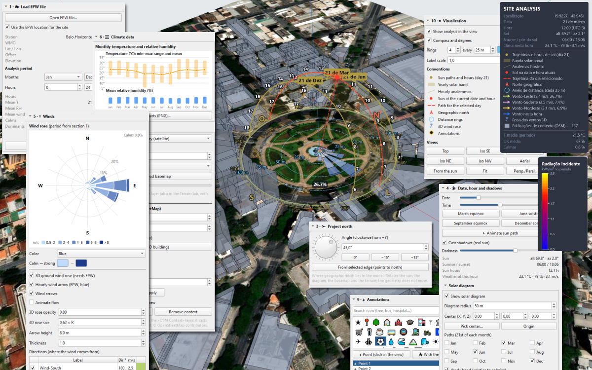
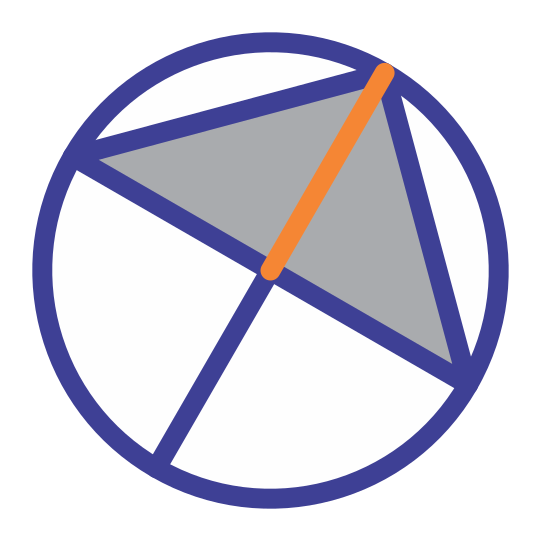
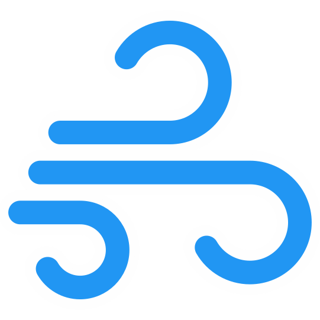
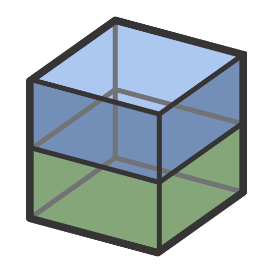
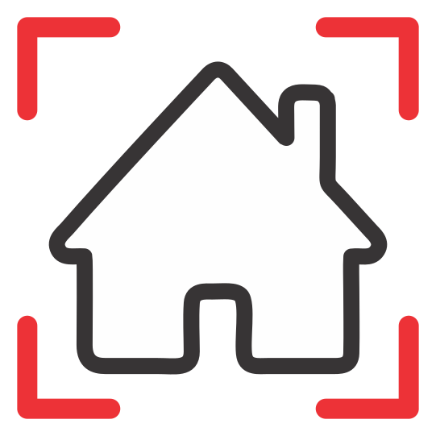
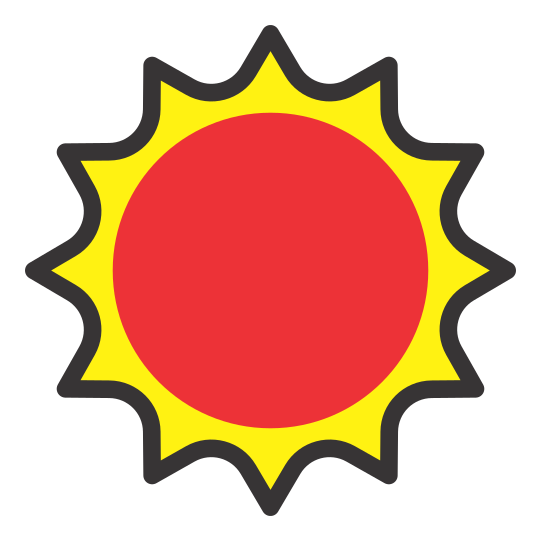
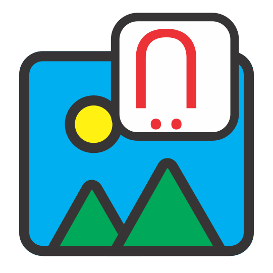
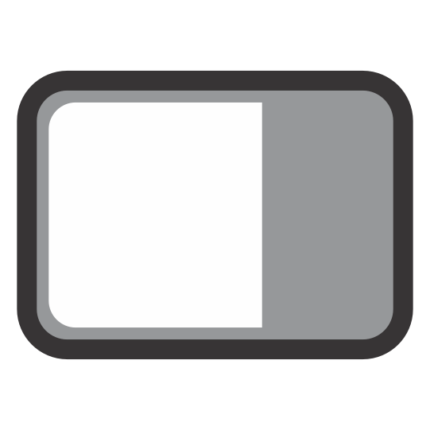

# Análisis de Sitio — extensión para IngeTrazo

**Análisis de Sitio para IngeTrazo**: sol 3D, sombras reales, viento, clima EPW,
radiación solar, contexto de OpenStreetMap, masas y lotes con áreas/índices,
anotaciones y exportación PNG — todo sobre el propio modelo.

Es la app web *Análisis de Sitio 3D* convertida en extensión,
como un plugin de SketchUp: no modifica el núcleo, todo entra por
`setup(app)` (API de extensiones 2).



## Autoría y créditos

La extensión es **obra de jufegofoto-cell**
([github.com/jufegofoto-cell/IngeAnalisys](https://github.com/jufegofoto-cell/IngeAnalisys)),
que convirtió la app web *Análisis de Sitio 3D* en extensión de IngeTrazo.
**Este repositorio es un fork** con las modificaciones que siguen y no
reivindica el trabajo original: el diseño, el método y el crédito son suyos.
Detalles de cada cambio y aviso de licencia: [`CREDITS.md`](CREDITS.md).

Lo que añade este fork (1.9.0):

- nueve catálogos de idioma — pt-BR, es, en, de, it, fr, zh-CN, ru, ja
  (`IngeAnalisys/i18n/`);
- el código organizado en carpetas — `tools/`, `i18n/`, `icons/`, un paquete
  con `__init__.py` y `setup(app)`;
- una barra de herramientas unificada con 19 botones e iconos SVG que siguen el
  tema claro/oscuro (`tools/toolbar.py`);
- paneles flotantes arrastrables: información y convenciones, y la escala de
  colores de los mapas de radiación y de sombra;
- correcciones de atajos de teclado y de la carga de diálogos. Probado y
  funcionando.

Mantenido por Ezequiel M. Rezende ([@em-rezende](https://github.com/em-rezende)).
Los proyectos guardados con la versión original se abren igual: sus claves
(`analisis_sitio`, `group.ext["analisis_sitio"]`) se siguen leyendo.

## Instalación

**Desde el catálogo** (lo fácil): **Extensiones ▸ Gestionar extensiones…**,
busca «Análisis de Sitio», instala y reinicia. El gestor descarga
`dist/IngeAnalisys.zip`, comprueba su SHA-256 y lo descomprime como
`plugins/ingeanalisys/`.

**A mano**, desde este repositorio o desde `dist/IngeAnalisys.zip`:

1. En IngeTrazo: **Extensiones ▸ Abrir carpeta de plugins**
   (Windows `%APPDATA%\ingetrazo\plugins\`, Linux/macOS `~/.local/share/ingetrazo/plugins/`).
2. Copia **solo** la carpeta `IngeAnalisys` (o descomprime
   `IngeAnalisys.zip` dentro de la carpeta de plugins). La ruta debe ser
   `plugins/IngeAnalisys/__init__.py`: una extensión es un paquete de
   Python, y una carpeta que contiene otra carpeta no lo es — IngeTrazo lo
   avisa en el menú en vez de cargarla.
3. Reinicia IngeTrazo. La pestaña **Análisis de Sitio** aparece en la
   bandeja lateral, se crea el submenú **Extensiones ▸ Análisis de Sitio**
   y se añade una barra de herramientas (`Análisis de Sitio`).

Requisitos: IngeTrazo ≥ 0.6.1 (API de extensiones 2). Sin dependencias
extra (PySide6 + NumPy, ya incluidos).

Las dos formas instalan el mismo código: la extensión es una carpeta con
`setup(app)` y ninguna subclase de `Tool`, así que no añade herramientas de
dibujo — instalarla con uno u otro nombre de carpeta funciona, y un proyecto
guardado con uno se abre con el otro (se leen las claves de datos de ambos;
`IngeAnalisys/tools/data.py`).

## Publicar en el catálogo de extensiones

`catalog/ingeanalisys.toml` es la ficha para el repositorio
[`ingetrazo-extensions`](https://github.com/ingelibre/ingetrazo-extensions):
nombre, resumen y licencia en español/inglés/portugués, la dirección de
descarga (`…/v1.9.0/dist/IngeAnalisys.zip`) y el SHA-256 de ese archivo
exacto.

1. `python scripts/build_zip.py --update-catalog` — genera
   `dist/IngeAnalisys.zip` (una carpeta, con `__init__.py` dentro) y escribe
   la versión y el hash en la ficha.
2. `python scripts/check_plugin.py` — importa el paquete como lo hace
   IngeTrazo y comprueba la ficha, el ZIP y la imagen contra las reglas de
   aquel repositorio.
3. Commit, etiqueta (`v1.9.0`) y push. La etiqueta forma parte de la
   dirección de descarga: lo que revisó una persona no puede cambiar después.
4. En `ingetrazo-extensions`, crea `extensions/ingeanalisys.toml` con el
   contenido de `catalog/ingeanalisys.toml` y sube
   `screenshots/ingeanalisys.jpg` (hecho por
   `python scripts/make_screenshot.py`, por debajo de 600 KB). Abre el pull
   request.

Una versión nueva es una etiqueta nueva, un ZIP nuevo y una ficha con
`version`, `download` y `sha256` actualizados — nada más.

## Idiomas

La extensión incluye **inglés** (claves integradas), **portugués (Brasil)**,
**español**, **alemán**, **italiano**, **francés**, **chino simplificado**,
**ruso** y **japonés** en `IngeAnalisys/i18n/` (`pt-BR.json`, `es.json`,
`de.json`, `it.json`, `fr.json`, `zh-CN.json`, `ru.json`, `ja.json`). El
idioma se resuelve en este orden:

1. `i18n.set_language(<explícito>)` — mayor prioridad.
2. `core.i18n.current_language()` de IngeTrazo (o
   `app.settings["language"]` cuando el host lo expone).
3. Locale del sistema vía `QLocale.system()`:

   - `pt*` → `pt-BR`
   - `es*` → `es`
   - `de*` → `de`
   - `it*` → `it`
   - `fr*` → `fr`
   - `zh*` → `zh-CN`
   - `ru*` → `ru`
   - `ja*` → `ja`
   - cualquier otro → `en`

Las claves ausentes vuelven a la cadena en inglés, así que una traducción
parcial nunca rompe la interfaz. Para cambiar el idioma en tiempo de
ejecución:

```python
import importlib, sys
# El host carga el paquete por ruta, como ingetrazo_plugin_<carpeta>: el nombre
# depende de la carpeta (IngeAnalisys a mano, ingeanalisys desde el catálogo).
pkg = next(k for k, m in sys.modules.items()
          if (getattr(m, "__file__", "") or "").replace("\\", "/")
              .endswith("/IngeAnalisys/__init__.py")
          or (getattr(m, "__file__", "") or "").replace("\\", "/")
              .endswith("/ingeanalisys/__init__.py"))
i18n = importlib.import_module(pkg + ".tools.i18n")
i18n.set_language("es")             # o "pt-BR", "de", "it", "fr",
                                    # "zh-CN", "ru", "ja", "en"
```

Luego reconstruye el panel/dock (recargando la extensión) para que las
etiquetas creadas en tiempo de construcción tomen el nuevo idioma. En la
próxima apertura, el idioma se **redetecta** desde el host / locale del SO;
`set_language(...)` no se guarda en el documento.

## El panel, sección por sección

La pestaña lateral sigue el mismo orden que la app web. Cada sección es
plegable; el número del título corresponde al orden de la pestaña.

### 1 · ☁ Cargar archivo EPW

- **Abrir archivo EPW…** — lee el archivo (UTF-8 o Latin-1) y guarda una
  copia compacta y redondeada en el `.igz` (`≈ 400 kB`). El EPW original no
  es necesario para reabrir el documento.
- **Usar la ubicación del EPW para el sitio** — cuando está marcado, las
  coordenadas y el huso del EPW pasan a ser la ubicación del proyecto
  (`scene.georef` de IngeTrazo).
- **Periodo de análisis** — rango de meses (`m0`–`m1`) y rango de horas
  (`h0`–`h1`). Los periodos pueden dar la vuelta al año (nov → feb) o a la
  noche (20 → 6).
- **Estadísticas** del periodo: horas, T media (con mín–máx), HR media,
  viento medio, calmas y los tres sectores dominantes (no adyacentes).
- **Quitar EPW** — limpia el clima guardado. Un paso de deshacer.

### 2 · ◉ Ubicación

- **Buscar dirección o pegar «lat, lon»** — geocodifica con el geocoder de
  IngeTrazo, o acepta `lat, lon` escrito directamente.
- **Elegir en el mapa…** — abre el selector de ubicación de IngeTrazo sobre
  el mapa base actual.
- **Latitud / Longitud / Aplicar coordenadas** — fija el datum manualmente.
- **Zona horaria** — `Automática (por longitud)` o un desfase UTC fijo.
- **Nombre** — nombre libre del sitio; usado en exportaciones y en el panel
  de información.

Mover el sitio cuando el proyecto ya tiene ubicación pide confirmación: el
origen pasa al nuevo punto y la geometría conserva sus coordenadas locales.

### 3 · ➤ Norte del proyecto

- **Dial + ángulo numérico (horario desde +Y)** — dónde queda el norte
  geográfico en el modelo. Gira el sol, el diagrama solar, el mapa base y
  el terreno 3D; **la geometría no se mueve**.
- **0° / −15° / +15°** — ajustes rápidos.
- **Desde la arista seleccionada (apunta al norte)** — elige una sola
  arista del modelo dibujada sur → norte; el ángulo se calcula a partir de
  ella.

### 4 · ☀ Fecha, hora y sombras

La fecha y la hora aquí son las **reales** usadas por las sombras de
IngeTrazo: mover una mueve las sombras del modelo, y mover las sombras
(desde el panel Sombras) mueve este panel. Una sola verdad.

- Slider de **Fecha** (1–365) y slider de **Hora** (0–24 en pasos de 15
  minutos).
- Botones **Equinoccio mar / Solsticio jun / Equinoccio sep / Solsticio
  dic**: saltan a los equinoccios y solsticios.
- **▶ Animar recorrido solar / ■ Detener** — recorre el día a 0,25 h por
  cuadro. El recorrido también mueve las sombras reales; se puede detener
  desde el panel o la barra.
- **Sombras proyectadas (sol real)** — alterna `scene.shadows.enabled`
  (misma acción que el botón Sombras de la barra de IngeTrazo).
- **Oscuridad** — oscuridad de las sombras (0–100 %).
- **Información del sol** — altitud, azimut, amanecer/ocaso, horas de sol
  hoy y clima a la hora actual (del EPW, si hay).

#### Diagrama solar (subsección)

- **Mostrar diagrama solar** — encendido/apagado general del diagrama 3D
  en la vista.
- **Radio del diagrama** y **Centro (X, Y, Z)** — geometría de la cúpula
  del cielo. **Elegir centro…** ejecuta una herramienta de un clic para
  posicionarlo; **Origen** vuelve a (0, 0, 0).
- **Trayectorias (día 21 de cada mes)** — casillas de selección por mes a
  dibujar.
- **Banda anual (solsticio a solsticio)**, **Analemas horarios**,
  **Trayectoria del día seleccionado**, **Etiquetas de horas y meses**,
  **Rayo solar al centro** — alternancias.
- Botones de color **Diagrama / Sol**.

### 5 · ≋ Vientos

- **Rosa de los vientos** — basada en EPW, 16 sectores × 5 rangos de
  velocidad. El periodo es el de la sección 1. Colores: **Ámbar / Azul /
  Turquesa / Verde / Violeta / Rojo / Gris / Personalizada**. El par de
  colores **Calma → fuerte** solo aplica a la paleta `Personalizada`.
- **Rosa de vientos 3D en el suelo (requiere EPW)** — dibuja la misma rosa
  en el suelo. Tiene **opacidad** y **tamaño (× R)**.
- **Flecha del viento horario (EPW, azul)** — muestra el viento a la hora
  actual de la sección 4.
- **Flechas de viento / Animar flujo** — dibuja las flechas de la tabla de
  vientos; `Animar` hace pulsar la cinta.
- **Tabla de direcciones** — una fila por flecha: encendido/apagado,
  etiqueta, dirección (de dónde viene el viento), velocidad (m/s), color.
  Doble clic en el color para cambiarlo. **+ Añadir** / **Quitar**.
- **Aplicar vientos dominantes (EPW)** — sustituye la tabla por los tres
  sectores dominantes del EPW.

### 6 · ☵ Datos climáticos

- Gráfico de **temperatura y humedad relativa mensual** del EPW (año
  completo, independientemente del periodo de análisis).
- **Guardar gráficos (PNG)…** — guarda la rosa de los vientos y el gráfico
  mensual en disco (`<stem>_rose.png`, `<stem>_months.png`).

### 7 · ▦ Mapa base y contexto

**Mapa base** (es la capa de mapa base del propio IngeTrazo):

- **Cartografía** — presets más **URL de teselas personalizada (XYZ)…**
- **URL** — solo aparece con `Personalizada` seleccionada. Debe contener
  `{z}`, `{x}`, `{y}`.
- **Extensión** (m) y **Zoom** (`Automático` o fijo).
- **Descargar mapa base**.
- **Mostrar mapa** y **Opacidad** — actúan sobre la capa de teselas viva.

**Edificios de contexto (OpenStreetMap)**:

- **Radio** y **Altura por defecto** — parámetros de la consulta Overpass.
- **Apoyar en el terreno 3D (si existe)** — cuando el terreno de IngeTrazo
  está activo, cada edificio se apoya en la cota más baja del terreno bajo
  su huella.
- **Cargar edificios 3D** — ejecuta la descarga Overpass en un hilo de
  fondo; el hilo principal solo toca el documento cuando llega la
  respuesta.
- **Mostrar edificios** — oculta/muestra el grupo de contexto (capa
  bloqueada `Contexto OSM`).
- **Color** y **Opacidad** — reestilizan el grupo sin reconstruirlo.
- **Escala de altura** — multiplica la altura de todos los edificios
  (`×`). Se aplica en **Aplicar**.
- **Editar edificios: clic en la vista** — convierte los clics de
  `Seleccionar` en edificios de contexto en selección. El panel
  **Edificio** debajo muestra el nombre del edificio elegido y permite
  cambiar **Altura** y **Base**, **Ocultar**, o **Mostrar ocultos** para
  todos.
- **Quitar contexto** — elimina el grupo OSM (un paso de deshacer).

### 8 · ⬛ Masas y lotes

Una **masa** es un grupo normal del modelo que recuerda su planta, altura,
cota base y tipo en `group.ext["analisis_sitio"]`. Se mueve, gira, pinta,
exporta a OBJ/SKP/IFC como cualquier otro grupo, y **proyecta sombra**. Un
**lote** es lo mismo sin altura (planta plana con área).

- **⬛ Masa desde selección** / **▬ Lote desde selección** — convierten
  la(s) cara(s) horizontal(es) seleccionada(s) en masas/lotes. La cara se
  vuelve la base y se quita del modelo suelto (un paso de deshacer).
- **Altura inicial** y **Altura de piso** — valores usados al crear nuevas
  masas.
- **Lista de masas** — una fila por masa/lote con su tipo, altura, pisos y
  área. Seleccionar una fila abre las propiedades debajo.
- **Propiedades**: **Nombre**, **Tipo** (Masa / Lote), **Altura**,
  **Pisos** (recalcula la altura a partir de la altura de piso), **Cota
  base**, **Color**, **Opacidad**.
- **Estadísticas**: área en planta, perímetro, volumen, área construida
  (con conteo de pisos), cota superior.
- **⟲ 15° / ⟳ 15° / Duplicar / Seleccionar / Eliminar** — operaciones de
  un clic.
- **Resumen** bajo la lista: número de masas, huella total, área
  construida, volumen, área de lotes, índice de ocupación, índice de
  construcción.

### 9 · ⌖ Anotaciones

- **Buscar icono** — filtra la lista de iconos por nombre en inglés o
  traducido.
- **Lista de iconos** — clic para elegir el icono de la próxima anotación.
- **⌖ Punto (clic en la vista)** — herramienta de captura, punto simple.
- **★ Con el icono elegido** — herramienta de captura, usa el icono
  elegido.
- **Lista de anotaciones** — una fila por anotación.
- **Texto** — etiqueta. **Usar icono elegido** / **Quitar icono** /
  **Eliminar**.
- **Estilo de las anotaciones**: colores **Icono · Texto · Línea**,
  **Fondo circular / etiqueta**, **Tamaño**, **Altura**, **Línea guía al
  terreno**, **Mostrar texto**. **Aplicar estilo a todas** limpia las
  sustituciones por anotación para que todas usen el estilo actual.
- Con la herramienta Seleccionar, clic en una anotación la selecciona;
  **Supr** la borra.

### 10 · ◐ Visualización

- **Mostrar el análisis en la vista** — encendido/apagado general
  (`view["on"]`).
- **Brújula y grados** — dibuja la brújula graduada.
- **Anillos** — conteo, paso, color.
- **Escala de etiquetas** — multiplicador de tamaño para todas las
  etiquetas del canvas.
- **Convenciones** — leyenda viva de todo lo visible en la vista (símbolo
  + nombre; los valores viven en sus secciones).
- **Vistas** — **Planta**, **Iso SE/SO/NE/NO**, **Aérea**, **Desde el
  sol**, **Encuadrar**, **Persp./Paral.**

### 11 · ☀ Radiación solar y sombras

Ambos cálculos corren sobre el propio modelo y dejan un grupo coloreado en
la vista, en la capa `Radiación Solar`. **Solo se muestra un mapa a la
vez** — el selector **Resultado en la vista** de la sección 11 alterna
entre ellos.

**Entradas comunes (ambos estudios)**:

- **Superficies** — Todo el modelo (sin contexto OSM) / Masas y lotes /
  Selección (caras o grupos) / Solo el suelo.
- **Resolución** — Por superficie (un color por cara), o malla de
  2 / 1 / 0,5 m.
- **Suelo alrededor** con margen — añade una malla de suelo cuadrada bajo
  el modelo (recortada bajo las bases de edificios y lotes).

**Radiación solar incidente**:

- **Periodo** — Día de la sección 4 / Un mes / Periodo de análisis
  (sección 1) / Año completo.
- **Albedo del suelo** — 0 … 0,9.
- **☀ Calcular radiación** — ejecuta el cálculo.
- Método: **directa** con sombras de toda la geometría visible (contexto
  incluido) + **difusa isótropa** con la vista real al cielo (145 parches
  de Tregenza) + **reflejada por el suelo** (albedo). Clima del EPW, o
  cielo despejado teórico cuando no hay EPW cargado.
- **Resultado**: kWh/m², con una **escala de color** flotante arriba a la
  derecha (debajo del panel de información si ambos están visibles). La
  escala se puede alternar en la sección 11 (**Mostrar panel flotante de
  la escala (radiación / sombras)**).
- **Colores**: Ecotect / Grises / Térmica.
- **Escala automática (mín–máx)** o **Mínimo / Máximo** fijados a mano.

**Estudio de sombras**:

- **Desde / Hasta** e **Intervalo** (15 / 20 / 30 / 60 min). Por defecto:
  el día de la sección 4.
- **◑ Calcular estudio de sombras** — ejecútalo.
- Cada celda acumula las **horas en sombra** en cada posición del sol
  muestreada (sombra proyectada y propia).
- **Mostrar**: **Horas de sombra** u **Horas de sol (asoleamiento)**. Los
  colores se mantienen por punto al alternar entre los dos — solo cambian
  las etiquetas.
- **Colores**: Grises (blanco = sol, negro = sombra), **Ecotect por horas**
  (una clase por hora, amarillo = sol → azul marino = sombra), Térmica.

Los dos mapas son **grupos bloqueados en la capa `Radiación Solar`**: se
guardan en el `.igz`, se eliminan en un paso de deshacer, y nunca
interfieren con la selección.

### 12 · ⇩ Exportar imagen

- **Resolución** — FHD / 2K / 4K / 5K.
- **Exportar imagen (PNG)…** — guarda la vista actual con todo el análisis
  encima, incluidos el panel de información flotante y la escala de
  radiación/sombras cuando están visibles.
- **Título del panel** y **Posición** (SD / SI / ID / II) — del panel de
  información flotante.
- **Mostrar panel flotante de información y convenciones** — alterna el
  panel. Viene **oculto al iniciar**: es un ajuste de sesión, no del
  documento (un `.igz` no lo reactiva al abrir).

## Barra de herramientas

Se crea una barra horizontal unificada en `setup()`. Es `Movable` y
`Floatable`, tiene un `objectName` distinto (para que el host guarde y
restaure la posición), y se puede ocultar por el menú nativo **Ver ▸
Barras de herramientas**.

Cada botón usa un **icono SVG de `icons/`** — el mismo archivo para el tema
oscuro (`<nombre>.svg`, trazo claro) y para el tema claro
(`<nombre>_light.svg`, trazo oscuro). El cargador es `tools/icons.py`; si
falta un SVG, el botón recurre a un glifo Unicode para que nada se rompa.

Todo botón tiene tooltip y atajo. Los botones están agrupados exactamente en
el mismo orden que las secciones del panel (1 a 12).

### Barra unificada — "Análisis de Sitio" (19 botones)

Camino rápido para las acciones principales de cada sección, más el
encendido/apagado del panel.

| Icono | Tooltip | Acción | Atajo |
|---|---|---|---|
|         | Abrir EPW…                      | `panel._on_open_epw()`           | `Shift+Y`     |
|         | Elegir ubicación en el mapa…    | `panel._on_pick_map()`           | `Shift+K`     |
|       | Definir norte de la arista      | `panel._on_pick_north_edge()`    | `Shift+C`     |
|         | Mostrar / ocultar el análisis   | `act.toggle_analysis(sitio)`     | `Shift+H`     |
|        | Animar el recorrido solar       | `panel._on_anim()`               | `Shift+Space` |
|        | Aplicar vientos dominantes (EPW)| `panel._on_dominant()`           | `Shift+W`     |
|       | Guardar gráficos del clima (PNG)…| `panel._on_save_charts()`       | `Shift+G`     |
|     | Descargar mapa base             | `panel._on_basemap()`            | `Shift+B`     |
|         | Cargar edificios de OSM         | `panel._on_osm()`                | `Shift+O`     |
|     | Quitar contexto OSM             | `act.set_context(sitio, None, …)`| `Shift+Delete`|
|        | Masa desde caras                | `panel._make_masses("mass")`     | `Shift+M`     |
|         | Lote desde caras                | `panel._make_masses("lot")`      | `Shift+L`     |
|        | Anotar con el icono elegido     | `panel._place_pin(True)`         | `Shift+A`     |
|    | Vista en planta                 | `panel.set_view("top")`          | `Shift+5`     |
|         | Encuadrar el sitio              | `panel.set_view("fit")`          | `Shift+0`     |
|         | Calcular radiación              | `panel._on_rad()`                | `Shift+R`     |
|      | Exportar PNG…                   | `panel._on_png()`                | `Shift+E`     |
|        | Mostrar / ocultar panel de información | `panel._on_notes(checked)` | `Shift+I`     |
|       | Mostrar / ocultar el panel de análisis | `app.show_panel(dock)` / `dock.hide()` | `Shift+P` |

`👁`, `▶`, `🎛` y `⚙` son **checkable** y se mantienen en sincronía con el
documento (`view["on"]`), el timer de animación del sol
(`sitio.animating_sun`), el panel de información (`sitio.show_notes`) y la
visibilidad del dock. La sincronización se hace desde `panel.refresh()`,
así que cualquier ruta que actualice el panel (cambio en el documento,
interacción del usuario, acción de menú) también actualiza la barra.

### Barra secundaria — "Análisis de Sitio — herramientas" (8 botones)

Utilidades y herramientas de análisis, también agrupadas por sección.

| Icono | Tooltip | Acción | Atajo |
|---|---|---|---|
|     | Guardar gráficos del clima (PNG)… | `panel._on_save_charts()`           | `Shift+G`      |
|   | Descargar mapa base             | `panel._on_basemap()`               | `Shift+B`      |
|       | Cargar edificios de OSM         | `panel._on_osm()`                   | `Shift+O`      |
|   | Quitar contexto OSM             | `act.set_context(sitio, None, …)`   | `Shift+Delete` |
|  | Vista en planta                 | `panel.set_view("top")`             | `Shift+5`      |
|       | Calcular radiación              | `panel._on_rad()`                   | `Shift+R`      |
|      | Mostrar / ocultar panel de información | `panel._on_notes(checked)` | `Shift+I`      |

`🎛` es **checkable** y se mantiene en sincronía con `sitio.show_notes`
(la casilla de la sección 12). `☷` oculta/muestra **todas** las barras de
la ventana principal (también las del propio IngeTrazo); las barras
flotantes se ignoran.

Si prefieres `Ctrl+5` / `Ctrl+0` o teclas de función para las dos vistas
rápidas, cambia la línea correspondiente en `tools/toolbar2.py` (busca
`"Shift+5"` / `"Shift+0"`). Los atajos usan `Qt.WindowShortcut`, así que
nunca interfieren con la vista 3D ni con la entrada de texto.

### Variantes de los iconos (tema oscuro / claro)

`tools/icons.py` elige la variante adecuada automáticamente desde la paleta
de la ventana:

- **Tema oscuro** (`QPalette.Window` con luminosidad < 128):
  `icons/<nombre>.svg` (trazo claro, blanco).
- **Tema claro** (luminosidad ≥ 128): `icons/<nombre>_light.svg`
  (trazo oscuro, negro); si falta el archivo `_light`, se usa el base.

Las tablas Markdown de arriba referencian la variante **`_light`** porque
la mayoría de los visores de Markdown usan fondo claro. En un lector
oscuro, cambia `_light` por el nombre base.

### Personalizar las barras

- **Añadir una acción**: en `tools/toolbar.py` o `tools/toolbar2.py`,
  añade una llamada `_add(...)` en `build()` y coloca el SVG en `icons/`.
  Los botones deben llamar a `panel.*` o `actions.*` — nunca contener
  lógica de negocio. Los tooltips nuevos deben pasar por `tr()` y añadirse
  a **todos** los catálogos en `i18n/`.
- **Quitar un grupo**: borra las llamadas `_add(...)` de ese grupo
  (conserva el separador `_gap` solo donde aún lo quieras).
- **Persistir estado**: las dos barras tienen `objectName`; si el host
  llama a `QMainWindow.saveState()/restoreState()`, la posición (y
  visibilidad) de cada una se restaura al reiniciar.

## Datos en el documento

`plugin_data["analisis_sitio"]` (anotaciones y vientos, con deshacer),
`analisis_sitio.view` (ajustes de visualización), `analisis_sitio.climate`
(EPW compacto), `analisis_sitio.context` (edificios OSM). Masas:
`group.ext["analisis_sitio"]`.

Los documentos antiguos que aún usan los nombres anteriores de clave
(`.vista` / `.clima` / `.contexto`) y los nombres anteriores de capa en
español/portugués se migran de forma transparente en el primer guardado
(ver `tools/data._LEGACY_KEYS` e `tools/i18n.migrate_layers`).

## Diferencias con la app web

- **Importación** (OBJ/DXF), **modelado** y **exportación OBJ** son tarea
  de IngeTrazo; la extensión trabaja sobre el modelo actual.
- **Tonalidad del mapa (claro/oscuro)** y **recolorear áreas verdes** no
  aplican: el mapa es la capa de mapa base de IngeTrazo (sí tiene
  opacidad).
- **Biblioteca de iconos** usa glifos Unicode para anotaciones. En sistemas
  sin fuente de emoji, la anotación dibuja un punto de color en lugar del
  glifo ausente. Las **barras de herramientas** usan iconos SVG de
  `icons/`.
- **Las anotaciones son siempre verticales** (la opción "en el suelo" de
  la app web no existe).
- **Extra**: las dos barras de herramientas, que la app web no tiene.

## Estructura de los archivos

```
IngeAnalisys/
  __init__.py          setup(app): imports de .tools.*, panel, dock,
                       overlay, pickables, menús, menú contextual,
                       outliner, ambas barras
  tools/
    __init__.py        marcador de paquete
    actions.py         operaciones sin interfaz (usadas por panel, menús, tests)
    charts.py          rosa de los vientos y clima mensual
    climate.py         EPW, estadísticas, rosa, paletas OKLab
    core.py            controlador: sitio, hora (= sombras), clima, animación
    data.py            valores del documento + paso de deshacer; helpers de etiqueta
    drawing.py         todo lo que se dibuja sobre la vista
    export.py          imagen PNG y gráficos del clima
    geometry.py        prismas, masas, contexto; nombres canónicos de capa
    i18n.py            tr(), set_language(), translate_layer(), migrate_layers()
                       (catálogos en <paquete>/i18n/, un nivel arriba)
    icons.py           cargador de SVG theme-aware (dark / light)
                       (SVG en <paquete>/icons/, un nivel arriba)
    osm.py             descarga Overpass en hilo de fondo
    panel.py           la pestaña lateral (secciones 1–12)
    pick_tool.py       herramienta de un clic con inferencias
                       (renombrada de tools.py — ver Solución de problemas)
    radiation.py       radiación incidente y horas de sombra (ray tracing)
    solar.py           trayectorias, analemas, banda, salida/puesta del sol
    toolbar.py         barra primaria (13 botones)
    toolbar2.py        barra secundaria (9 botones)
  i18n/
    pt-BR.json         portugués (Brasil)
    es.json            español
    de.json            alemán
    it.json            italiano
    fr.json            francés
    zh-CN.json         chino simplificado
    ru.json            ruso
    ja.json            japonés
  icons/
    epw.svg             epw_light.svg
    pin.svg             pin_light.svg
    north.svg           north_light.svg
    eye.svg             eye_light.svg
    play.svg            play_light.svg
    wind.svg            wind_light.svg
    mass.svg            mass_light.svg
    lot.svg             lot_light.svg
    star.svg            star_light.svg
    fit.svg             fit_light.svg
    sun.svg             sun_light.svg
    export.svg          export_light.svg
    panel.svg           panel_light.svg
    chart.svg           chart_light.svg
    basemap.svg         basemap_light.svg
    osm.svg             osm_light.svg
    osm_off.svg         osm_off_light.svg
    view_top.svg        view_top_light.svg
    info.svg            info_light.svg
  screenshots/
    Section_01.png      load EPW
    Section_02.png      location
    Section_03.png      project north
    Section_04.png      date, hour and shadows
    Section_05.png      winds
    Section_06.png      climate data
    Section_07.png      basemap and context
    Section_08.png      masses and lots
    Section_09.png      annotations
    Section_10.png      visualization
    Section_11.png      solar radiation and shadows
    Section_12.png      export image
catalog/
  ingeanalisys.toml    la ficha para copiar en ingetrazo-extensions
scripts/
  build_zip.py         dist/IngeAnalisys.zip (una carpeta, __init__.py) + hash
  check_plugin.py      importa el plugin como IngeTrazo; comprueba la ficha
  make_screenshot.py   screenshots/ingeanalisys.jpg para el catálogo (<600 KB)
dist/
  IngeAnalisys.zip     el archivo que descarga el catálogo (versionado a propósito)
```

## Pruebas

Aquí no hay un IngeTrazo que importar, así que `scripts/check_plugin.py`
sustituye el host (`core.mesh`, `core.history`, `tools.base`… por clases
falsas), carga el paquete **por ruta de archivo, como
`ingetrazo_plugin_<carpeta>`** — exactamente lo que hace
`core/extensions.py` — e importa todos los módulos de `tools/`:

```
python scripts/check_plugin.py                # todo
python scripts/check_plugin.py --no-import    # sin Qt ni numpy
```

También comprueba la ficha del catálogo, el ZIP (una carpeta, `__init__.py`
dentro, por debajo de 5 MB, hash igual al de la ficha) y la imagen, y
ejercita las claves de datos de una instalación antigua. Un import roto
muestra el módulo y la excepción en vez de desaparecer en el menú de
Extensiones.

## Solución de problemas

- **Panel invisible**: `Extensiones ▸ Análisis de Sitio ▸ Mostrar panel`, o
  el botón de icono `panel` de la barra primaria. Si no aparece nada en
  absoluto, abre el terminal de IngeTrazo (ver abajo) o la consola y revisa
  `sys.modules`; la causa típica es un `ImportError` dentro de `tools/`,
  que aborta el `setup()` antes de crear cualquier widget.

  **Trampa de archivo renombrado**: `tools/pick_tool.py` debe tener ese
  nombre exacto. `pick_tools.py` (con "s" al final) produce
  `ImportError: cannot import name 'pick_tool'` y la extensión entera deja
  de cargar en silencio. La corrección es renombrar a `pick_tool.py` (o
  recrear el archivo — el contenido no cambió cuando se renombró desde
  `tools/tools.py`).

- **Idioma incorrecto**: verifica que cada `i18n/*.json` sea JSON válido.
  ```
  python -m json.tool IngeAnalisys/i18n/es.json > NUL
  ```
  (repite para `pt-BR`, `de`, `it`, `fr`, `zh-CN`, `ru`, `ja`).
  Un catálogo malformado hace que el plugin caiga a inglés en silencio.
  En la consola de IngeTrazo:
  ```python
  import sys, importlib
  pkg = next(k for k, m in sys.modules.items()
             if (getattr(m, "__file__", "") or "").replace("\\", "/")
                 .endswith("IngeAnalisys/__init__.py"))
  i18n = importlib.import_module(pkg + ".tools.i18n")
  i18n.set_language(None)
  print(i18n.debug_info())
  ```
  El plugin se carga en IngeTrazo con el nombre
  `ingetrazo_plugin_<carpeta>` (`ingetrazo_plugin_IngeAnalisys` a mano,
  `ingetrazo_plugin_ingeanalisys` desde el catálogo), así que
  `from IngeAnalisys import i18n` falla dentro de la consola — usa el
  fragmento de arriba.

- **Los iconos no aparecen**: la carpeta `icons/` debe estar al lado de
  `__init__.py` (raíz del paquete), **no** dentro de `tools/`.
  `tools/icons.py` calcula `_ROOT = os.path.dirname(_HERE)` y busca
  `icons/` desde ahí. Sin los SVG, los botones recurren a glifos Unicode —
  la barra sigue funcionando, pero con los iconos equivocados.

- **Los atajos no se disparan**: otra extensión o el host pueden tener el
  mismo `Shift+…`. Cambia el atajo en `tools/toolbar.py` /
  `tools/toolbar2.py` (busca `shortcut="Shift+...`).

- **El mapa de radiación/sombras no aparece**: revisa el selector
  **Resultado en la vista** en la sección 11 (solo se muestra un mapa a la
  vez) y confirma que la capa `Radiación Solar` está visible.

- **La descarga de OSM falla**: Overpass limita el uso intenso. Espera un
  minuto o reduce el radio en la sección 7.

## Licencia

GPL-3.0-or-later, como IngeTrazo. Datos de edificios de contexto
© colaboradores de OpenStreetMap.
```
