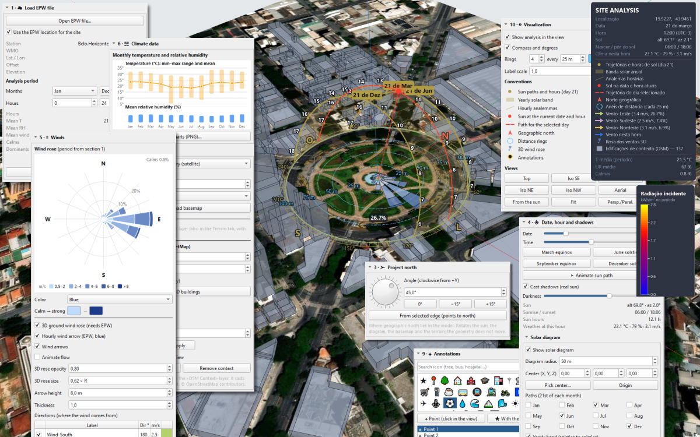
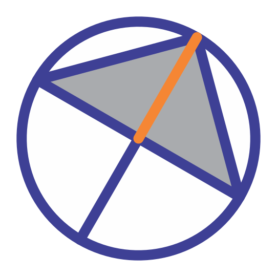
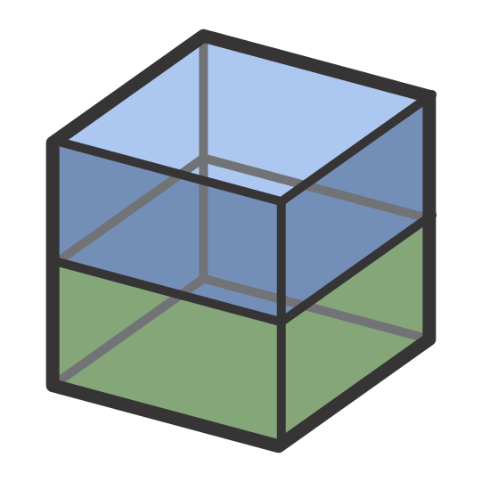
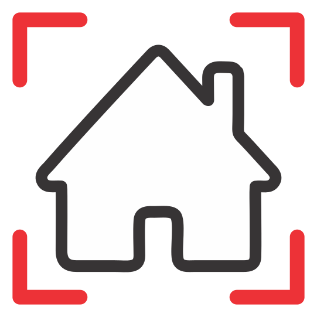
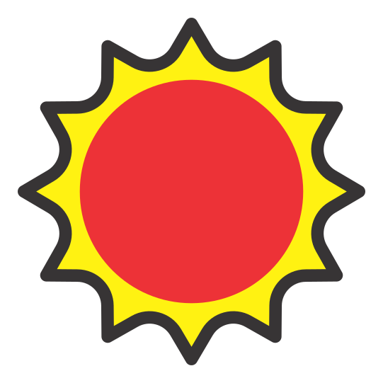
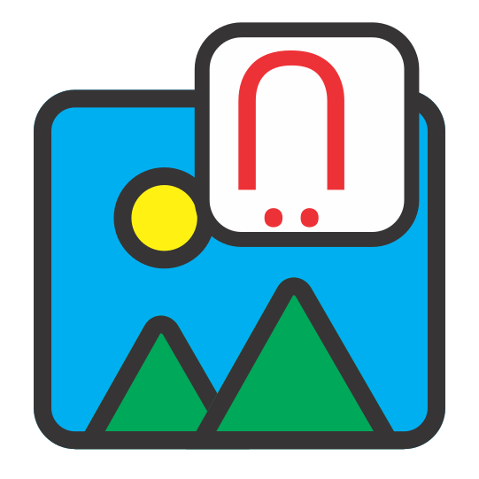
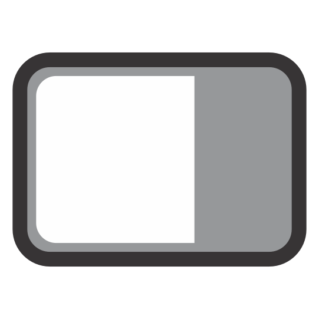

# Análise de Sítio — extensão para o IngeTrazo

**Análise de Sítio para IngeTrazo**: sol 3D, sombras reais, vento, clima EPW,
radiação solar, contexto OpenStreetMap, massas e lotes com áreas/índices,
anotações e exportação PNG — tudo no próprio modelo.

É o app web *Análisis de Sitio 3D* transformado em extensão, como
um plugin de SketchUp: não modifica o núcleo, tudo entra por `setup(app)`
(API de extensões 2).



## Instalação

**Pelo catálogo** (o caminho fácil): **Extensões ▸ Gerenciar extensões…**,
procure «Análise de Sítio», instale e reinicie. O gerenciador baixa
`dist/IngeAnalisys.zip`, confere o SHA-256 e descompacta como
`plugins/ingeanalisys/`.

**À mão**, a partir deste repositório ou de `dist/IngeAnalisys.zip`:

1. No IngeTrazo: **Extensões ▸ Abrir pasta de plugins**
   (Windows `%APPDATA%\ingetrazo\plugins\`, Linux/macOS `~/.local/share/ingetrazo/plugins/`).
2. Copie **apenas** a pasta `IngeAnalisys` (ou descompacte
   `IngeAnalisys.zip` dentro da pasta de plugins). O caminho deve ser
   `plugins/IngeAnalisys/__init__.py`: um plugin é um pacote Python, e uma
   pasta que contém outra pasta não é um pacote — o IngeTrazo avisa no menu
   em vez de carregar.
3. Reinicie o IngeTrazo. A aba **Análise de Sítio** aparece na bandeja
   lateral, o submenu **Extensões ▸ Análise de Sítio** é criado, e **uma
   barra de ferramentas** é adicionada (`Análise de Sítio`).

Requisitos: IngeTrazo ≥ 0.6.1 (API de extensões 2). Sem dependências extras
(PySide6 + NumPy, já incluídos).

As duas formas instalam o mesmo código: o plugin é uma pasta com
`setup(app)` e nenhuma subclasse de `Tool`, então nada é acrescentado às
ferramentas de desenho — instalar sob um ou outro nome de pasta funciona, e
um projeto salvo com um abre com o outro (as chaves de dados das duas são
lidas; `IngeAnalisys/tools/data.py`).

## Publicar no catálogo de extensões

`catalog/ingeanalisys.toml` é a ficha para o repositório
[`ingetrazo-extensions`](https://github.com/ingelibre/ingetrazo-extensions):
nome, resumo e licença em espanhol/inglês/português, o endereço de download
(`…/v1.9.0/dist/IngeAnalisys.zip`) e o SHA-256 desse arquivo exato.

1. `python scripts/build_zip.py --update-catalog` — gera
   `dist/IngeAnalisys.zip` (uma pasta, com `__init__.py` dentro) e grava a
   versão e o hash na ficha.
2. `python scripts/check_plugin.py` — importa o pacote como o IngeTrazo faz
   e confere a ficha, o ZIP e a imagem contra as regras daquele repositório.
3. Commit, tag (`v1.9.0`) e push. A tag faz parte do endereço de download: o
   que o revisor leu não pode mudar depois.
4. No `ingetrazo-extensions`, crie `extensions/ingeanalisys.toml` com o
   conteúdo de `catalog/ingeanalisys.toml` e envie
   `screenshots/ingeanalisys.jpg` (gerado por
   `python scripts/make_screenshot.py`, abaixo de 600 KB). Abra o pull
   request.

Uma versão nova é uma tag nova, um ZIP novo e uma ficha com `version`,
`download` e `sha256` atualizados — nada além disso.

## Idiomas

A extensão vem com **inglês** (chaves embutidas), **português (Brasil)**,
**espanhol**, **alemão**, **italiano**, **francês**, **chinês simplificado**,
**russo** e **japonês** em `IngeAnalisys/i18n/` (`pt-BR.json`, `es.json`,
`de.json`, `it.json`, `fr.json`, `zh-CN.json`, `ru.json`, `ja.json`). O
idioma é resolvido nesta ordem:

1. `i18n.set_language(<explícito>)` — maior prioridade.
2. `core.i18n.current_language()` do IngeTrazo (ou
   `app.settings["language"]` quando o host expõe).
3. Locale do sistema via `QLocale.system()`:

   - `pt*` → `pt-BR`
   - `es*` → `es`
   - `de*` → `de`
   - `it*` → `it`
   - `fr*` → `fr`
   - `zh*` → `zh-CN`
   - `ru*` → `ru`
   - `ja*` → `ja`
   - qualquer outro → `en`

Chaves ausentes caem de volta para a string em inglês, então uma tradução
parcial nunca quebra a interface. Para trocar o idioma em tempo de execução:

```python
import importlib, sys
# O host carrega o pacote pelo caminho, como ingetrazo_plugin_<pasta>: o nome
# depende da pasta (IngeAnalisys à mão, ingeanalisys pelo catálogo).
pkg = next(k for k, m in sys.modules.items()
          if (getattr(m, "__file__", "") or "").replace("\\", "/")
              .endswith("/IngeAnalisys/__init__.py")
          or (getattr(m, "__file__", "") or "").replace("\\", "/")
              .endswith("/ingeanalisys/__init__.py"))
i18n = importlib.import_module(pkg + ".tools.i18n")
i18n.set_language("pt-BR")          # ou "es", "de", "it", "fr",
                                    # "zh-CN", "ru", "ja", "en"
```

Depois, recrie o painel/dock (recarregando a extensão) para que os rótulos
criados em tempo de construção peguem o novo idioma. Na próxima abertura, o
idioma é **redetectado** a partir do host / locale do SO; `set_language(...)`
não é persistido no documento.

## O painel, seção por seção

A aba lateral segue a mesma ordem do app web. Cada seção é recolhível; o
número no título corresponde à ordem da aba.

### 1 · ☁ Carregar arquivo EPW

- **Abrir arquivo EPW…** — lê o arquivo (UTF-8 ou Latin-1) e guarda uma
  cópia compacta e arredondada no `.igz` (`≈ 400 kB`). O EPW original não é
  necessário para reabrir o documento. O diálogo de arquivo abre na pasta
  **Downloads** do usuário.
- **Usar a localização do EPW para o sítio** — quando marcado, as
  coordenadas e o fuso do EPW passam a ser a localização do projeto
  (`scene.georef` do IngeTrazo).
- **Período de análise** — faixa de meses (`m0`–`m1`) e faixa de horas
  (`h0`–`h1`). Os períodos podem dar a volta no ano (nov → fev) ou na noite
  (20 → 6).
- **Estatísticas** do período: horas, T média (com mín–máx), UR média, vento
  médio, calmas e os três setores dominantes (não adjacentes).
- **Remover EPW** — limpa o clima guardado. Um passo de desfazer.

### 2 · ◉ Localização

- **Buscar endereço ou colar «lat, lon»** — geocodifica com o geocoder do
  IngeTrazo, ou aceita `lat, lon` digitado diretamente.
- **Escolher no mapa…** — abre o seletor de localização do IngeTrazo sobre o
  mapa base atual.
- **Latitude / Longitude / Aplicar coordenadas** — define o datum manualmente.
- **Fuso horário** — `Automática (por longitude)` ou um deslocamento UTC
  fixo.
- **Nome** — nome livre do sítio; usado nas exportações e no painel de
  informação.

Mover o sítio quando o projeto já tem localização pede confirmação: a origem
passa para o novo ponto e a geometria mantém suas coordenadas locais.

### 3 · ➤ Norte do projeto

- **Perilla + ângulo numérico (horário desde +Y)** — onde fica o norte
  geográfico no modelo. Gira o sol, o diagrama solar, o mapa base e o
  terreno 3D; **a geometria não se move**.
- **0° / −15° / +15°** — ajustes rápidos.
- **Da aresta selecionada (aponta para o norte)** — duas formas de usar:
  - **Painel**: selecione uma aresta (desenhada sul → norte) no modelo e
    clique no botão do painel. O ângulo é calculado na hora.
  - **Barra (`➤`)**: clique no botão e clique na aresta direto na vista 3D.
    O plugin monitora a seleção por ~150 ms e aplica o norte assim que
    houver exatamente uma aresta selecionada.

### 4 · ☀ Data, hora e sombras

A data e a hora aqui são as **reais** usadas pelas sombras do IngeTrazo:
mover uma move as sombras do modelo, e mover as sombras (do painel Sombras)
move este painel. Uma única verdade.

- Slider de **Data** (1–365) e slider de **Hora** (0–24 em passos de 15
  minutos).
- Botões **Equinócio de março / Solstício de junho / Equinócio de setembro /
  Solstício de dezembro**: saltam para os equinócios e solstícios.
- **▶ Animar trajetória solar / ■ Parar** — varre o dia a 0,25 h por quadro.
  A varredura também move as sombras reais; pode ser parada pelo painel ou
  pela barra.
- **Projetar sombras (sol real)** — alterna `scene.shadows.enabled` (mesma
  ação do botão Sombras da barra do IngeTrazo).
- **Escuridão** — escuridão das sombras (0–100 %).
- **Informação do sol** — altitude, azimute, nascer/pôr do sol, horas de sol
  hoje e clima na hora atual (do EPW, se houver).

#### Diagrama solar (subseção)

- **Mostrar diagrama solar** — liga/desliga geral do diagrama 3D na vista.
- **Raio do diagrama** e **Centro (X, Y, Z)** — geometria da cúpula do céu.
  **Escolher centro…** roda uma ferramenta de um clique para posicioná-lo;
  **Origem** volta para (0, 0, 0).
- **Trajetórias (dia 21 de cada mês)** — caixas de seleção para cada mês a
  desenhar.
- **Banda anual (solstício a solstício)**, **Analemas horárias**,
  **Trajetória do dia selecionado**, **Etiquetas de horas e meses**,
  **Raio solar ao centro** — alternâncias.
- Botões de cor **Diagrama / Sol**.

### 5 · ≋ Ventos

- **Rosa dos ventos** — baseada no EPW, 16 setores × 5 faixas de
  velocidade. O período é o definido na seção 1. Cores: **Âmbar / Azul /
  Turquesa / Verde / Violeta / Vermelho / Cinza / Personalizada**. O par de
  cores **Calma → forte** só vale para a paleta `Personalizada`.
- **Rosa dos ventos 3D no solo (requer EPW)** — desenha a mesma rosa no
  solo. Tem **opacidade** e **tamanho (× R)**.
- **Seta do vento horário (EPW, azul)** — mostra o vento na hora atual da
  seção 4.
- **Setas de vento / Animar fluxo** — desenha as setas da tabela de ventos;
  `Animar` faz a fita pulsar.
- **Tabela de direções** — uma linha por seta: liga/desliga, rótulo,
  direção (de onde vem o vento), velocidade (m/s), cor. Duplo clique na cor
  para alterá-la. **+ Adicionar** / **Remover**.
- **Aplicar ventos dominantes (EPW)** — substitui a tabela pelos três
  setores dominantes do EPW (também na barra, no botão `◑`).

### 6 · ☵ Dados climáticos

- Gráfico de **temperatura e umidade relativa mensal** do EPW (ano inteiro,
  independentemente do período de análise).
- **Salvar gráficos (PNG)…** — salva a rosa dos ventos e o gráfico mensal em
  disco. O diálogo abre na pasta **Documentos** do usuário, com nome
  sugerido `climate.png`, gerando `<stem>_rose.png` e `<stem>_months.png`.

### 7 · ▦ Mapa base e contexto

**Mapa base** (é a camada de mapa base do próprio IngeTrazo):

- **Cartografia** — presets mais **URL de tiles personalizada (XYZ)…**
- **URL** — só aparece quando `Personalizada` está selecionada. Deve conter
  `{z}`, `{x}`, `{y}`.
- **Extensão** (m) e **Zoom** (`Automático` ou fixo).
- **Baixar mapa base**.
- **Mostrar mapa** e **Opacidade** — atuam na camada de tiles viva.

**Edificações de contexto (OpenStreetMap)**:

- **Raio** e **Altura padrão** — parâmetros da consulta Overpass.
- **Apoiar no terreno 3D (se existir)** — quando o terreno do IngeTrazo está
  ligado, cada edificação senta na cota mais baixa do terreno sob sua
  huella.
- **Carregar edificações 3D** — roda o download Overpass em uma thread de
  fundo; a thread principal só toca o documento quando a resposta chega.
- **Mostrar edificações** — oculta/mostra o grupo de contexto (camada
  bloqueada `Contexto OSM`).
- **Cor** e **Opacidade** — restilizam o grupo sem reconstruí-lo.
- **Escala de altura** — multiplica a altura de todas as edificações (`×`).
  Aplica em **Aplicar**.
- **Editar edificações: clique na vista** — transforma cliques de
  `Selecionar` em edificações de contexto em seleção. O painel **Edificação**
  abaixo mostra o nome da edificação escolhida e permite alterar **Altura**
  e **Base**, **Ocultar**, ou **Mostrar ocultas** para todas.
- **Remover contexto** — apaga o grupo OSM (um passo de desfazer).

### 8 · ⬛ Massas e lotes

Uma **massa** é um grupo normal do modelo que lembra sua planta, altura,
cota base e tipo em `group.ext["analisis_sitio"]`. Move-se, gira, pinta,
exporta para OBJ/SKP/IFC como qualquer outro grupo, e **projeta sombra**.
Um **lote** é o mesmo sem altura (planta plana com área).

- **⬛ Massa da seleção** / **▬ Lote da seleção** — convertem a(s) face(s)
  horizontal(is) selecionada(s) em massas/lotes. A face se torna a base e é
  removida do modelo solto (um passo de desfazer).
- **Altura inicial** e **Altura de piso** — padrões usados ao criar novas
  massas.
- **Lista de massas** — uma linha por massa/lote com tipo, altura, pisos e
  área. Selecionar uma linha abre as propriedades abaixo.
- **Propriedades**: **Nome**, **Tipo** (Massa / Lote), **Altura**,
  **Pisos** (recalcula a altura a partir da altura de piso), **Cota base**,
  **Cor**, **Opacidade**.
- **Estatísticas**: área em planta, perímetro, volume, área construída (com
  contagem de pisos), cota superior.
- **⟲ 15° / ⟳ 15° / Duplicar / Selecionar / Eliminar** — operações de um
  clique.
- **Resumo** abaixo da lista mostra totais: número de massas, huella total,
  área construída, volume, área de lotes, índice de ocupação, índice de
  construção.

### 9 · ⌖ Anotações

- **Buscar ícone** — filtra a lista de ícones por nome em inglês ou
  traduzido.
- **Lista de ícones** — clique para escolher o ícone da próxima anotação.
- **⌖ Ponto (clique na vista)** — ferramenta de captura, ponto simples.
- **★ Com o ícone selecionado** — ferramenta de captura, usa o ícone
  escolhido.
- **Lista de anotações** — uma linha por anotação.
- **Texto** — rótulo. **Usar ícone selecionado** / **Remover ícone** /
  **Eliminar**.
- **Estilo das anotações**: cores **Ícone · Texto · Linha**, **Fundo
  circular / etiqueta**, **Tamanho**, **Altura**, **Linha-guia ao terreno**,
  **Mostrar texto**. **Aplicar estilo a todas** limpa as substituições por
  anotação para que todas usem o estilo atual.
- Com a ferramenta Selecionar, clicar em uma anotação a seleciona; **Supr**
  a remove.

### 10 · ◐ Visualização

- **Mostrar a análise na vista** — liga/desliga geral (`view["on"]`).
- **Bússola e graus** — desenha a bússola graduada.
- **Anéis** — contagem, passo, cor.
- **Escala de etiquetas** — multiplicador de tamanho para todas as etiquetas
  do canvas.
- **Convenções** — legenda viva de tudo o que está visível na vista
  (símbolo + nome; os valores ficam em suas seções).
- **Vistas** — **Planta**, **Iso SE/SO/NE/NO**, **Aérea**, **Do sol**,
  **Enquadrar**, **Persp./Paral.**

### 11 · ☀ Radiação solar e sombras

Os dois cálculos rodam sobre o próprio modelo e deixam um grupo colorido na
vista, na camada `Radiação Solar`. **Só um mapa é mostrado por vez** — o
seletor **Resultado na vista** da seção 11 alterna entre eles.

**Entradas comuns (ambos os estudos)**:

- **Superfícies** — Todo o modelo (excluindo o contexto OSM) / Massas e
  lotes / Seleção (faces ou grupos) / Só o solo.
- **Resolução** — Por superfície (uma cor por face), ou malha de
  2 / 1 / 0,5 m.
- **Solo ao redor** com margem — adiciona uma malha de solo quadrada sob o
  modelo (recortada sob as bases de edificações e lotes).

**Radiação solar incidente**:

- **Período** — Dia da seção 4 / Um mês / Período de análise (seção 1) /
  Ano completo.
- **Albedo do solo** — 0 … 0,9.
- **☀ Calcular radiação** — roda o cálculo.
- Método: **direta** com sombras de toda a geometria visível (contexto
  incluído) + **difusa isotrópica** com a vista real ao céu (145 patches de
  Tregenza) + **refletida pelo solo** (albedo). Clima do EPW, ou céu limpo
  teórico quando não há EPW carregado (a dica abaixo do botão diz isso).
- **Resultado**: kWh/m², com um **painel flutuante da escala de cores**
  (arrastável, veja abaixo) que pode ser alternado em **Mostrar painel
  flutuante da escala (radiação / sombras)**.
- **Cores**: Ecotect / Cinzas / Térmica.
- **Escala automática (mín–máx)** ou **Mínimo / Máximo** definidos à mão.

**Estudo de sombras**:

- **De / Até** e **Intervalo** (15 / 20 / 30 / 60 min). Padrão: o dia da
  seção 4.
- **◑ Calcular estudo de sombras** — roda o cálculo.
- Cada célula acumula as **horas em sombra** em cada posição do sol
  amostrada (sombra projetada e própria).
- **Mostrar**: **Horas de sombra** ou **Horas de sol (insolação)**. As
  cores ficam por ponto ao alternar entre os dois — só os rótulos mudam.
- **Cores**: Cinzas (branco = sol, preto = sombra), **Ecotect por horas**
  (uma classe por hora, amarelo = sol → azul-marinho = sombra), Térmica.

Os dois mapas são **grupos bloqueados na camada `Radiação Solar`**: são
salvos no `.igz`, removidos em um passo de desfazer, e nunca interferem na
seleção.

### 12 · ⇩ Exportar imagem

- **Resolução** — FHD / 2K / 4K / 5K.
- **Exportar imagem (PNG)…** — salva a vista atual com toda a análise por
  cima, incluindo o painel de informação flutuante e a escala de
  radiação/sombras quando visíveis. O diálogo abre na pasta **Documentos**
  do usuário, com nome sugerido `<nome_do_sítio>_analysis.png` (ou
  `site_analysis.png` se o sítio não tiver nome).
- **Título do painel** e **Posição** (SD / SE / ID / IE) — do painel de
  informação flutuante.
- **Mostrar painel flutuante de informação e convenções** — alterna o
  painel. Ele vem **oculto ao iniciar**: é um ajuste de sessão, não do
  documento (um `.igz` não o religa ao abrir).

## Painéis flutuantes

A extensão desenha dois painéis flutuantes arrastáveis sobre a vista 3D:

- **Análise de Sítio** — o painel de informações e convenções (ativado na
  seção 12). Mostra o sítio, data, hora, sol, clima na hora atual, uma
  legenda viva do que está visível e a média climática do período de
  análise.
- **Radiação / Sombras** — a escala de cores do mapa de radiação ou de
  sombras exibido no momento (ativada na seção 11). Só aparece quando há
  um mapa visível **e** a caixa correspondente marcada.

Ambos podem ser **arrastados com o mouse** para qualquer canto da vista. O
estado ligado/desligado é salvo no `.igz`, mas a posição na tela é um ajuste
de sessão. Ao exportar a vista em PNG, os dois painéis aparecem na imagem
na posição em que estiverem.

## Barra de ferramentas

Uma barra horizontal unificada (`Análise de Sítio`) é criada em `setup()`.
Ela é `Movable` e `Floatable`, tem um `objectName` distinto (para o host
salvar/restaurar a posição), e pode ser ocultada pelo menu nativo **Ver ▸
Barras de ferramentas**.

Cada botão usa um **ícone SVG de `icons/`** — o mesmo arquivo para o tema
escuro (`<nome>.svg`, traço claro) e para o tema claro (`<nome>_light.svg`,
traço escuro). O carregador é `tools/icons.py`; se um SVG faltar, o botão
cai em um glifo Unicode para nada quebrar.

Os botões estão agrupados exatamente na mesma ordem das seções do painel
(1 a 12), com um separador antes do botão de ligar/desligar o painel no
final.

| Seção | Ícone | Tooltip | Ação | Atalho |
|---|---|---|---|---|
| 1  |         | Abrir EPW…                       | `panel._on_open_epw()`            | `Shift+Y`     |
| 2  |         | Escolher localização no mapa…    | `panel._on_pick_map()`            | `Shift+K`     |
| 3  |       | Definir norte da aresta          | `panel._on_pick_north_edge()`     | `Shift+C`     |
| 4  |         | Mostrar / ocultar a análise      | `act.toggle_analysis(sitio)`      | `Shift+H`     |
| 4  |        | Animar a trajetória solar        | `panel._on_anim()`                | `Shift+Space` |
| 5  |        | Aplicar ventos dominantes (EPW)  | `panel._on_dominant()`            | `Shift+W`     |
| 6  |       | Salvar gráficos do clima (PNG)…  | `panel._on_save_charts()`         | `Shift+G`     |
| 7  |     | Baixar mapa base                 | `panel._on_basemap()`             | `Shift+B`     |
| 7  |         | Carregar edificações do OSM      | `panel._on_osm()`                 | `Shift+O`     |
| 7  |     | Remover contexto OSM             | `act.set_context(sitio, None, …)` | `Shift+Delete`|
| 8  |        | Massa a partir das faces         | `panel._make_masses("mass")`      | `Shift+M`     |
| 8  |         | Lote a partir das faces          | `panel._make_masses("lot")`       | `Shift+L`     |
| 9  |        | Anotar com o ícone selecionado   | `panel._place_pin(True)`          | `Shift+A`     |
| 10 |    | Vista em planta                  | `panel.set_view("top")`           | `Shift+5`     |
| 10 |         | Enquadrar o sítio                | `panel.set_view("fit")`           | `Shift+0`     |
| 11 |         | Calcular radiação                | `panel._on_rad()`                 | `Shift+R`     |
| 12 |      | Exportar PNG…                    | `panel._on_png()`                 | `Shift+E`     |
| 12 |        | Mostrar / ocultar painel de informação | `panel._on_notes(checked)`  | `Shift+I`     |
| —  |       | Mostrar / ocultar o painel de análise | `app.show_panel(dock)` / `dock.hide()` | `Shift+P` |


`👁`, `▶`, `🎛` e `⚙` são **checkable** e ficam em sincronia com o
documento (`view["on"]`), o timer de animação do sol
(`sitio.animating_sun`), o painel de informação (`sitio.show_notes`) e a
visibilidade do dock. A sincronização é feita em `panel.refresh()`, então
qualquer caminho que atualiza o painel (mudança no documento, interação do
usuário, ação de menu) também atualiza a barra.

### Variantes dos ícones (tema escuro / claro)

O `tools/icons.py` escolhe a variante certa automaticamente pela paleta da
janela:

- **Tema escuro** (`QPalette.Window` com luminosidade < 128):
  `icons/<nome>.svg` (traço claro, branco).
- **Tema claro** (luminosidade ≥ 128): `icons/<nome>_light.svg`
  (traço escuro, preto); se o arquivo `_light` faltar, o base é usado.

A tabela Markdown acima referencia a variante **`_light`** porque a
maioria dos visualizadores de Markdown usa fundo claro. Em um leitor
escuro, troque `_light` pelo nome base.

### Personalizar a barra

- **Adicionar uma ação**: em `tools/toolbar.py`, acrescente uma chamada
  `_add(...)` em `build()` e coloque o SVG em `icons/`. Os botões devem
  chamar `panel.*` ou `actions.*` — nunca conter lógica de negócio.
  Tooltips novos precisam passar por `tr()` e ser adicionados a **todos**
  os catálogos em `i18n/`.
- **Remover um botão**: apague a chamada `_add(...)` correspondente.
- **Persistir estado**: a barra tem `objectName`; se o host chamar
  `QMainWindow.saveState()/restoreState()`, a posição (e visibilidade) é
  restaurada ao reiniciar.

## Onde os diálogos começam

Para não abrir na pasta de instalação do IngeTrazo, os diálogos de arquivo
começam em pastas do usuário:

- **Abrir EPW…** → pasta **Downloads**.
- **Salvar gráficos (PNG)…** → pasta **Documentos**, com nome sugerido
  `climate.png`.
- **Exportar imagem (PNG)…** → pasta **Documentos**, com nome sugerido
  `<nome_do_sítio>_analysis.png` (ou `site_analysis.png`).

Você pode navegar para outra pasta dentro do diálogo normalmente.

## Dados no documento

`plugin_data["analisis_sitio"]` (anotações e ventos, com desfazer),
`analisis_sitio.view` (ajustes de visualização), `analisis_sitio.climate`
(EPW compacto), `analisis_sitio.context` (edificações OSM). Massas:
`group.ext["analisis_sitio"]`.

Documentos antigos que ainda usam os nomes anteriores de chave
(`.vista` / `.clima` / `.contexto`) e os nomes anteriores de camada em
espanhol/português são migrados de forma transparente na primeira gravação
(ver `tools/data._LEGACY_KEYS` e `tools/i18n.migrate_layers`).

## Diferenças em relação ao app web

- **Importação** (OBJ/DXF), **modelagem** e **exportação OBJ** são trabalho
  do IngeTrazo; a extensão trabalha sobre o modelo atual.
- **Tonalidade do mapa (claro/escuro)** e **recolorir áreas verdes** não se
  aplicam: o mapa é a camada de mapa base do IngeTrazo (ela tem opacidade).
- **Biblioteca de ícones** usa glifos Unicode para anotações. Em sistemas
  sem fonte de emoji, a anotação desenha um ponto colorido no lugar do
  glifo ausente. A **barra de ferramentas** usa ícones SVG de `icons/`.
- **Anotações são sempre eretas** (a opção "no chão" do app web não existe).
- **A mais**: uma barra unificada com 19 botões (o app web não tem nenhuma)
  e dois painéis flutuantes arrastáveis.

## Limitações conhecidas

- As anotações são sempre desenhadas de frente para o usuário; a opção "no
  chão" do app web não existe aqui.
- A tonalidade clara/escura do mapa base é a do IngeTrazo; só a opacidade é
  ajustável por esta extensão.
- Os glifos dos ícones nas anotações dependem das fontes instaladas no
  sistema. Se um glifo não existir, é desenhado um ponto colorido.
- Alguns atalhos podem colidir com outras extensões ou com o host. Todos
  os atalhos ficam em `tools/toolbar.py` e podem ser alterados livremente.

## Estrutura dos arquivos

```
IngeAnalisys/
  __init__.py          setup(app): i18n, painel, dock, overlay, pickables,
                       menus, menu de contexto, outliner, barra
  tools/
    __init__.py        marcador de pacote
    actions.py         operações sem interface (usadas por painel, menus, testes)
    charts.py          rosa dos ventos e clima mensal
    climate.py         EPW, estatísticas, rosa, paletas OKLab
    core.py            controlador: sítio, hora (= sombras), clima, animação
    data.py            valores do documento + passo de desfazer; helpers de rótulo
    drawing.py         tudo o que é desenhado sobre a vista + FloatingBox
    export.py          imagem PNG e gráficos do clima
    geometry.py        prismas, massas, contexto; nomes canônicos de camada
    i18n.py            tr(), set_language(), translate_layer(), migrate_layers()
                       (catálogos ficam em <pacote>/i18n/, um nível acima)
    icons.py           carregador de SVG theme-aware (dark / light)
                       (SVGs ficam em <pacote>/icons/, um nível acima)
    osm.py             download Overpass em thread de fundo
    panel.py           a aba lateral (seções 1–12)
    pick_tool.py       ferramenta de um clique com inferências
    radiation.py       radiação incidente e horas de sombra (traçado de raios)
    solar.py           trajetórias, analemas, banda, nascer/pôr do sol
    toolbar.py         barra unificada (19 botões)
  i18n/
    pt-BR.json         português (Brasil)
    es.json            espanhol
    de.json            alemão
    it.json            italiano
    fr.json            francês
    zh-CN.json         chinês simplificado
    ru.json            russo
    ja.json            japonês
  icons/
    epw.svg             epw_light.svg
    pin.svg             pin_light.svg
    north.svg           north_light.svg
    eye.svg             eye_light.svg
    play.svg            play_light.svg
    wind.svg            wind_light.svg
    chart.svg           chart_light.svg
    basemap.svg         basemap_light.svg
    osm.svg             osm_light.svg
    osm_off.svg         osm_off_light.svg
    mass.svg            mass_light.svg
    lot.svg             lot_light.svg
    star.svg            star_light.svg
    view_top.svg        view_top_light.svg
    fit.svg             fit_light.svg
    sun.svg             sun_light.svg
    export.svg          export_light.svg
    info.svg            info_light.svg
    panel.svg           panel_light.svg
catalog/
  ingeanalisys.toml    a ficha para copiar no ingetrazo-extensions
scripts/
  build_zip.py         dist/IngeAnalisys.zip (uma pasta, __init__.py) + hash
  check_plugin.py      importa o plugin como o IngeTrazo; confere a ficha
  make_screenshot.py   screenshots/ingeanalisys.jpg para o catálogo (<600 KB)
dist/
  IngeAnalisys.zip     o arquivo que o catálogo baixa (versionado de propósito)
```

## Testes

Não há um IngeTrazo aqui para importar, então `scripts/check_plugin.py`
substitui o host (`core.mesh`, `core.history`, `tools.base`… por classes
falsas), carrega o pacote **pelo caminho do arquivo, como
`ingetrazo_plugin_<pasta>`** — exatamente o que `core/extensions.py` faz — e
importa todos os módulos de `tools/`:

```
python scripts/check_plugin.py                # tudo
python scripts/check_plugin.py --no-import    # sem Qt ou numpy
```

Ele também confere a ficha do catálogo, o ZIP (uma pasta, `__init__.py`
dentro, abaixo de 5 MB, hash igual ao da ficha) e a imagem, e exercita as
chaves de dados de uma instalação antiga. Um import quebrado mostra o módulo
e a exceção em vez de desaparecer no menu de Extensões.

A barra também é exercitada pela suíte (registra sem erro e sua função
`refresh()` não depende de uma viewport visível).

## Solução de problemas

- **Painel invisível**: `Extensões ▸ Análise de Sítio ▸ Mostrar painel`, o
  botão `⚙` da barra, ou a caixa `Análise de Sítio` em **Ver ▸ Barras de
  ferramentas** (para a própria barra). Se nada aparecer mesmo assim, abra
  o terminal do IngeTrazo (veja abaixo) ou a console e verifique
  `sys.modules`; a causa típica é um `ImportError` dentro de `tools/`, que
  aborta o `setup()` antes de qualquer widget ser criado.

  **Armadilha de arquivo renomeado**: `tools/pick_tool.py` precisa ter
  exatamente esse nome. `pick_tools.py` (com "s" no final) produz
  `ImportError: cannot import name 'pick_tool'` e a extensão inteira
  silenciosamente deixa de carregar. A correção é renomear de volta para
  `pick_tool.py`.

- **Idioma errado**: verifique se cada `i18n/*.json` é um JSON válido.
  ```
  python -m json.tool IngeAnalisys/i18n/pt-BR.json > NUL
  ```
  (repita para `es`, `de`, `it`, `fr`, `zh-CN`, `ru`, `ja`).
  Um catálogo malformado faz o plugin cair em inglês silenciosamente.
  Na console do IngeTrazo:
  ```python
  import sys, importlib
  pkg = next(k for k, m in sys.modules.items()
             if (getattr(m, "__file__", "") or "").replace("\\", "/")
                 .endswith("IngeAnalisys/__init__.py"))
  i18n = importlib.import_module(pkg + ".tools.i18n")
  i18n.set_language(None)
  print(i18n.debug_info())
  ```
  O plugin é carregado pelo IngeTrazo com o nome
  `ingetrazo_plugin_<pasta>` (`ingetrazo_plugin_IngeAnalisys` à mão,
  `ingetrazo_plugin_ingeanalisys` pelo catálogo), então
  `from IngeAnalisys import i18n` falha dentro da console — use o trecho
  acima.

- **Ícones não aparecem**: a pasta `icons/` deve ficar ao lado do
  `__init__.py` (raiz do pacote), **não** dentro de `tools/`.
  `tools/icons.py` calcula `_ROOT = os.path.dirname(_HERE)` e procura
  `icons/` a partir daí. Sem os SVGs, os botões caem em glifos Unicode —
  a barra continua funcionando, mas com os ícones errados.

- **Atalhos não disparam**: outra extensão ou o host pode ter o mesmo
  `Shift+…`. Troque o atalho em `tools/toolbar.py` (procure por
  `shortcut="Shift+...`).

- **Painel flutuante não aparece**: o painel **Análise de Sítio** só
  aparece quando a caixa da seção 12 está marcada; o painel **Radiação /
  Sombras** só aparece quando há um mapa de radiação ou de sombras visível
  **e** a caixa da seção 11 está marcada. Ambos podem ser arrastados com o
  mouse.

- **Mapa de radiação/sombras não aparece**: verifique o seletor **Resultado
  na vista** na seção 11 (só um mapa é mostrado por vez) e confirme que a
  camada `Radiação Solar` está visível.

- **Download OSM falha**: o Overpass limita uso pesado. Aguarde um minuto ou
  reduza o raio na seção 7.

## Licença

GPL-3.0-or-later, como o IngeTrazo. Dados de edificações de contexto
© colaboradores do OpenStreetMap.
```
